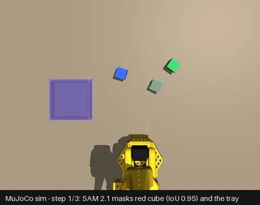
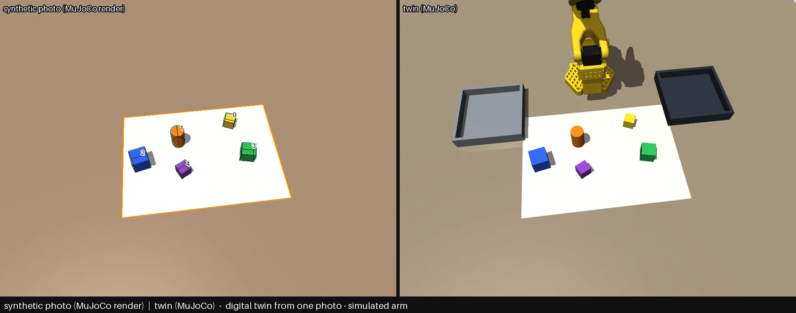

# Hasami (鋏)



*Recorded run `20261021T053112874Z` in the MuJoCo simulation, frames as stored (cropped; captions added under
each frame): SAM 2.1's masks (pick mint, place lilac), then the frame after the simulated SO-101 placed the cube.*

**Click what to move; SAM 2.1 sees it, a simulated SO-101 picks it, checks its own work and retries.**
A camera frame becomes masks, metric 3D grasps and a verified pick-and-place on the official SO-101 model in
MuJoCo. A photo of your desk with an A4 sheet becomes a digital twin the simulated arm can work in.

| Running now, no key needed | Waiting |
|---|---|
| SAM 2.1 hiera-tiny on this Mac · the SO-101 in MuJoCo (simulated) · the 8-family benchmark · the digital twin (on rendered photos) · dashboard, HTTP API, MCP | Muse planner and SAM 3.1: `MODEL_API_KEY` (Setup required, never called yet) · a real SO-101 (no arm attached) · a real desk photo with a ruler check |

**146/160** benchmark tasks solved (8 families x 20 seeds, simulated-click planner, SAM 2.1) · under
injected disturbances the robot's own check matched the physics in **1106 of 1111** checks · twin from one
photo: **86/86** objects found, **1.2 mm** mean centre error on 20 rendered photos.

```bash
git clone https://github.com/nickthelegend/hasami && cd hasami
scripts/setup.sh                     # .venv with '.[dev]' (pytest too), the dashboard build, SAM 2.1 weights
.venv/bin/python -m hasami_server    # http://127.0.0.1:8420 — click a cube, click the tray, Run
```

**Muse plans (wired; it runs once a Meta Model API key is set), SAM 2.1 sees, a simulated SO-101 picks.**
Every number in this README is SAM 2.1 with a clicked or scripted planner, not Muse. Say what you want
moved: Muse (Meta Model API) is to read the camera frame and plan the steps (Setup required:
`MODEL_API_KEY`, never called yet), SAM segments each object, depth turns each mask into a 3D grasp, and a
MuJoCo simulation of the SO-101 arm picks and places it, checking every step and retrying when it fails. No
real SO-101 has run.

**Sim-first, scored against ground truth.** The arm is the official SO-101 model in MuJoCo. The pipeline
sees only RGB + depth and the gripper's own position; the simulator's ground truth is used only to score
it. The simulation is kind by default (perfect depth, no sensor noise, ideal lighting); one benchmark sheet
adds depth noise, a calibration error and lighting jitter to measure that. Every number below is from the sim.

Built for the [Meta Global AI Developer Hackathon](https://cerebralvalley.ai/e/meta-ai-developer-hackathon)
(Indie track). Hasami is Japanese for scissors, the shape of the SO-101's gripper.

**Built before the event, and what is left for it.** The event runs Oct 26 – Nov 4, 2026. Hasami was
started on Oct 20 (first commit `5390ae3`), and everything up to the tag `pre-event-2026-10-22` predates the
event: the simulation, SAM 2.1 perception, the benchmark, the digital twin on rendered photos, the real
camera tab, the agent trace, MCP, the dashboard, the landing and both test suites. The tag sits on the last
commit made before the event (it is moved forward with each later pre-event commit, and the final
pre-event head is tagged `pre-event-2026-10-25` if work lands after Oct 22), so `git log <tag>..main` lists
only work done during it. Left for the event: the live Muse plan and SAM 3.1 (they need `MODEL_API_KEY`), a
Muse benchmark row, a twin from a real photo, and the narrated video. The official rules were not published
yet on Oct 22; see [HACKATHON_SUBMISSION_FORM.md](HACKATHON_SUBMISSION_FORM.md).

## Benchmark

`scripts/bench.py` runs seeded task families and checks each goal against the physics state. Planner:
**simulated-click planner** (an oracle: it knows which object each step moves and clicks the middle of its
colour blob in the rendered image; it is not a language model, so this measures perception, grasping,
placing and recovery, not planning). Segmenter: SAM 2.1 hiera-tiny, local. Up to 2 retries per step.
Eight families: all-to-tray, sort-by-colour, stack-two, clear-except-X, tower-of-3, **sort-by-shape**
(cylinders to the tray, cubes to the bin, the rest stay), **line-up** (three cubes in a row on the table,
smallest to largest, left to right), **pick-from-bin** (take the named object out of a bin of three).

Every pick target is checked before the arm moves (`hasami_perception.plausible`). The narrow side must fit
the open jaws (41 mm). The long side must be within the scene's object sizes, allowing for an object
lying down or leaning on an edge. The top must be at an object's height, the centre inside the reach
annulus or a container, and the mask must not run off the frame. A target that fails gets SAM 2.1 again
with a box (from the step's last good mask, or one object-size around the pixel). Then the colour the label
names, or a raised blob, is searched near the pixel, and each candidate is checked again, colour included.
If nothing passes, the step is **skipped as `implausible`** and the arm is not moved.

Clean, 20 seeds per family ([`20261021T173703Z.json`](deployments/bench/20261021T173703Z.json), with the check):

| Family | Planner | Tasks solved | Steps placed | Failures (segment / implausible / grasp / place / goal) | Retries | Check agrees |
|---|---|---:|---:|---|---:|---:|
| all-to-tray | simulated-click planner | **20/20** | 60/60 | 0 / 0 / 0 / 0 / 0 | 0 | 60/60 |
| sort-by-colour | simulated-click planner | **20/20** | 62/62 | 0 / 0 / 0 / 0 / 0 | 0 | 62/62 |
| stack-two | simulated-click planner | **20/20** | 20/20 | 0 / 0 / 0 / 0 / 0 | 0 | 20/20 |
| clear-except-X | simulated-click planner | **20/20** | 60/60 | 0 / 0 / 0 / 0 / 0 | 0 | 60/60 |
| tower-of-3 | simulated-click planner | **12/20** | 37/40 | 0 / 2 / 1 / 0 / 5 | 14 | 52/52 |
| sort-by-shape | simulated-click planner | **20/20** | 59/59 | 0 / 0 / 0 / 0 / 0 | 0 | 59/59 |
| line-up | simulated-click planner | **20/20** | 60/60 | 0 / 0 / 0 / 0 / 0 | 0 | 60/60 |
| pick-from-bin | simulated-click planner | **14/20** | 16/20 | 0 / 0 / 4 / 0 / 2 | 9 | 29/29 |
| **all** | | **146/160** | 374/381 | | 23 | 402/402 |

Failure classes: **segment** (the mask, or the object it led to, was wrong), **implausible** (skipped
before any move: no located target passed the check), **grasp** (the jaws never held it), **place** (held
but did not end up at the target), **goal** (every step passed its check but the final arrangement did not,
e.g. a stack shifted). *Check agrees*: how often the robot's own check (gripper position + camera) matched
the physics outcome. What fails: towers of three (seeds 10-19 are harder than 0-9, where 9/10 pass: five
stacks shift after every step passed), and picking out of the bin (four grasps stop on the way down, the
jaws meeting the bin's wall or a neighbour; twice a neighbour is dragged).

### Before and after the target check (same seeds, same commands)

| Sweep | Before: tasks | After: tasks | Before: failures | After: failures | Retries | Skipped as implausible | Check agrees |
|---|---:|---:|---|---|---:|---:|---:|
| Clean, seeds 0-19 | 146/160 | 146/160 | segment 1, grasp 6, goal 7 | implausible 2, grasp 5, goal 7 | 25 → 23 | 2 steps | 406/406 → 402/402 |
| Scripted plan, hints 20 px off, seeds 0-9 | 76/80 | 76/80 | grasp 3, goal 1 | implausible 1, grasp 2, goal 1 | 9 → 8 | 1 step | 198/198 → 196/196 |
| Noisy camera, seeds 0-9 | 63/80 | **64/80** | segment 12, grasp 5 | segment 3, implausible 11, grasp 2 | 51 → 35 | 18 steps | 237/240 → 201/206 |
| Grasp offset + slips, seeds 0-7 | 41/64 | 41/64 | grasp 13, segment 7, goal 2, place 1 | implausible 10, grasp 9, goal 2, segment 1, place 1 | 184 → 172 | 13 steps | 331/331 → 307/307 |

Files, before → after: clean [`165535Z`](deployments/bench/20261021T165535Z.json) →
[`173703Z`](deployments/bench/20261021T173703Z.json); scripted [`170448Z`](deployments/bench/20261021T170448Z.json) →
[`174610Z`](deployments/bench/20261021T174610Z.json); noisy [`170928Z`](deployments/bench/20261021T170928Z.json) →
[`175048Z`](deployments/bench/20261021T175048Z.json); grasp faults [`171443Z`](deployments/bench/20261021T171443Z.json) →
[`175539Z`](deployments/bench/20261021T175539Z.json). Before = b1d6bfa, after = with the target check.

Per family, after (tasks solved; before in brackets where it changed):

| Family | Scripted plan, hints 20 px off | Noisy camera | Grasp offset + slips |
|---|---:|---:|---:|
| all-to-tray | 10/10 | 10/10 | 7/8 |
| sort-by-colour | 10/10 | 6/10 | 6/8 |
| stack-two | 10/10 | 9/10 | 7/8 |
| clear-except-X | 10/10 | 6/10 | 4/8 |
| tower-of-3 | 9/10 | 8/10 | 5/8 |
| sort-by-shape | 10/10 | **6/10** (5/10) | 0/8 |
| line-up | 10/10 | 10/10 | 7/8 |
| pick-from-bin | 7/10 | 9/10 | 5/8 |
| **all** | **76/80**, 8 retries | **64/80** (63/80), 35 retries | **41/64**, 172 retries |

What changed, honestly:

- **The arm is no longer sent to things that are not objects.** Before, the noisy-camera sweep had 24 step
  records where the arm aimed more than 100 mm off (IK residual over 100 mm, or a localisation error over
  50 mm), and the grasp-fault sweep had 13. After, the noisy sweep has none. The grasp-fault sweep has one,
  a lift that stalled on a correctly located cylinder (0.8 mm off), which is not a leak.
- **It mostly relabels losses; it rarely turns them into wins.** Most of the noisy-camera segment losses
  are now `implausible`. In those cases the object had already left the pick pixel: a tipped cylinder fell
  into the tray, rolled off, or a cube fell off a tower. So the boxed re-prompt and the colour search find
  nothing of the right colour nearby, and the step is skipped rather than flown to the table's middle.
  Skipping costs fewer retries (51 → 35) and saved one sort-by-shape task. The bench JSON records only each
  step's final outcome. A step the fallback rescued shows up as a placed step, so the sweeps do not count
  rescues on their own; `tests/test_plausible.py` runs both rescue paths on demand.
- **Some skips are real objects out of reach:** a cube or cylinder knocked to 84-103 mm from the base axis
  (inside the base's dead zone; the reach annulus starts at 160 mm), or out to 293-298 mm. The old code
  tried those and stopped in the air; now they count as `implausible`, not `grasp`.
- **Still open:** three noisy-camera `segment` losses where SAM's plausible mask was the wrong object
  (right size, wrong one), and the check disagreeing with physics 5 times in the noisy sweep (all "image
  says failed, physics says placed"; 3 before).
- Fewer checks after (e.g. 406 → 402): a skipped attempt never moves, so it has no image check.

The sweeps, unchanged from the last pass:

- **Scripted plan** (`--planner scripted --hint-px 20`): each task's plan written by code in the Muse
  format, the object named by colour and shape and its hint pixel moved 20 px in a random direction, so the
  grounding layer has to find it. It is not a language model either.
- **Noisy camera** (`HASAMI_DISTURB=depth_mm:2,cam_mm:3,light:0.3`): 2 mm Gaussian noise on every depth
  pixel, the camera's believed position 3 mm off, lighting brightness ±30 % with a tint.
- **Grasp offset + slips** (`HASAMI_DISTURB=offset_mm:6,slip:0.2`): every first grasp aimed 6 mm off so
  the fixed finger lands on the object, 20 % of grips let go after the lift. What is lost is the
  disturbance's own damage, worst for 40 mm cylinders, which the misaimed finger knocks over (sort-by-shape
  0/8).

Over the four new files the robot's own check matched the physics in 1106 of 1111 checks (1172 of 1175
before). Earlier results are kept: the four pre-check files above, and the five-family files
[`052238Z`](deployments/bench/20261021T052238Z.json), [`052444Z`](deployments/bench/20261021T052444Z.json),
[`052717Z`](deployments/bench/20261021T052717Z.json).

Reproduce:

```bash
python scripts/bench.py --family all --seeds 20
python scripts/bench.py --family all --seeds 10 --planner scripted --hint-px 20
HASAMI_DISTURB=depth_mm:2,cam_mm:3,light:0.3 python scripts/bench.py --family all --seeds 10
HASAMI_DISTURB=offset_mm:6,slip:0.2 python scripts/bench.py --family all --seeds 8
python scripts/bench.py --family all --seeds 5 --planner muse                # needs MODEL_API_KEY
```

The Muse planner has not been benchmarked: no key yet (`--planner muse` prints
`Setup required: MODEL_API_KEY` and writes nothing).

## Your desk, twinned

**Digital twin from one photo · simulated arm.** Photograph a desk with an A4 sheet on it. The sheet gives
the table plane and the camera's pose; SAM 2.1, prompted at a grid of points on the plane, finds every
object; each mask is fitted as an upright box or cylinder whose projected silhouette matches it (height
estimated from the silhouette, or typed); MuJoCo builds the scene with the SO-101 beside the sheet and
renders it from the photo's own viewpoint. Then the simulated arm runs a task on the twin (clear the desk,
sort by colour, stack two) with the same grounding, checks and retries, scored by the same goal predicates.



*Left: a synthetic photo (MuJoCo render), not a real one. Right: its twin.* Measured on 20 such photos
(`scripts/twin_accuracy.py --seeds 20 --tasks`, [`accuracy-20261021T164701Z.json`](deployments/twins/accuracy-20261021T164701Z.json)),
only the RGB image given to the pipeline:

| | True field of view | Assumed 70° (a real photo's default) |
|---|---:|---:|
| Objects found / false positives | **86/86** / 0 | 83/86 / 1 |
| Shape (box vs cylinder) / colour right | 83/86 / 86/86 | 83/83 / 83/83 |
| Centre error, mean / max | **1.2 / 4.9 mm** | 3.3 / 14.3 mm |
| Yaw error, median / max | 0.35° / 22° | 0.57° / 3.5° |
| Height error, mean / median / max | **1.6** / 0.9 / 13.7 mm | 2.8 / 1.7 / 17.7 mm |
| clear-desk on the twin (simulated-click planner) | **16/20** goals met | — |

`POST /api/twin` (photo body), the dashboard's **Twin** tab (upload, or "Try a synthetic photo"), and
`GET /api/twin/sample.png` for a rendered test photo. Limits: tested on rendered photos only (a real desk
photo is pending); white objects on the sheet and objects the colour of the table are missed; an object over
a sheet corner needs the corners clicked; the field of view is assumed unless known. Method:
[`packages/docs`](packages/docs/README.md#your-desk-twinned-digital-twin-from-one-photo--simulated-arm).

## Pipeline

```
"put the red things in the tray and the blue things in the grey bin"
   │  Muse (muse-spark-1.3, image + instruction) ── plan: pick "red cube" @ hint (u,v), place "tray" @ (u,v)
   │  [waits for MODEL_API_KEY: never called; the image + forced-tool call is unverified until then.
   │   Today a clicked plan, the simulated-click oracle or a scripted Muse-format plan enters here]
   ▼
grounding: SAM 2.1 at the hint ─ check size, distance, raised, colour ─ else colour blob ─ else raised blob
           (or SAM 3.1 on the Meta Model API by name, validated the same way: also waits for the key)
   ▼
mask + metric depth ── centre, top height, yaw, footprint (square / elongated / round) ── grasp axis + width
   ▼
SO-101 in MuJoCo: closed-loop IK above → descend → close → lift → carry → lower to measured surface → open
   ▼
check: gripper position (held?) + camera (pick spot clear? object at the place spot?) ── fail → re-find, retry ≤ 2
   ▼
score (not used by the robot): physics state, goal predicate
   (optional mirror mode: a LeRobot follower repeats the joint targets; wired, never run on hardware)
```

## What is real, what is waiting

| Part | State |
|---|---|
| Arm | The official SO-101 MuJoCo model (TheRobotStudio, Apache-2.0) with force-limited STS3215 position servos. A pick only counts if the jaws physically hold the object. |
| Camera | Simulated overhead RGB + metric depth. Ground-truth segmentation scores perception; it is never an input. |
| SAM 2.1 | `facebook/sam2.1-hiera-tiny`, open weights, on this Mac. Every number here comes from it. |
| Grasp + image check, retry | Running: gripper position after close / lift / carry, SAM on the frame after each step, re-find and retry. SSE `verify` / `retry`. |
| Scenes | Procedural (`mujoco.MjSpec`): 20/25/30 mm cubes, blocks, flat boxes, 40 mm cylinders, six colours, 4–8 objects, tray + grey bin. Stacking works (place height from the measured surface). |
| Muse planner | `muse-spark-1.3` at `https://api.meta.ai/v1` (the model id and base URL are in the dev.meta.ai docs; the image part and the forced tool call on Chat Completions are unverified until a key exists). **Setup required: `MODEL_API_KEY`.** Without it `/api/plan` answers 503 `setup_required`; never a canned plan. Grounding of its hints is tested in the sim with deliberately bad hints. |
| SAM 3.1 | `sam-3.1` via `POST /v1/responses` (both confirmed in the docs); the special-token output is parsed per the docs. Its mask payload can be decoded only by Meta's `meta-sam-parser`, which is **not installed and not a dependency**, so in a run today a SAM 3.1 answer would be used for its box only: SAM 2.1 is prompted at the box centre and that mask is checked as usual. **Setup required: `MODEL_API_KEY`; unverified until then.** |
| Real SO-101 | Wired into `Session` behind `HASAMI_SO101_PORT`: a connected LeRobot follower mirrors every joint target the simulated arm is commanded (≤ 6° per joint and gripper per command, ~30 Hz; the first command is measured from the arm's present position, read when mirroring starts). `/api/status` says `"arm": "so101"` only while one is connected. Unit conversion tested; **never run on hardware. BLOCKED: no arm attached** (`HASAMI_SO101_PORT` + `pip install lerobot[feetech]`). |
| Digital twin | One desk photo with an A4 sheet → a MuJoCo scene with the simulated arm (`POST /api/twin`, Twin tab). 86/86 objects found, 1.2 mm mean centre error on 20 rendered photos; **a real photo is pending.** |
| Real camera | Dashboard tab: webcam frame (`HASAMI_REALCAM`) or a photo, A4 sheet / ArUco for the table plane (portrait or landscape, read from the corners in the order clicked, from any first corner), SAM 2.1 on a clicked object (mouse or keyboard), x / y / yaw / size on the plane (typed height, parallax-corrected). Segment and locate only; the arm stays simulated. Geometry tested on synthetic cameras; **ruler check on real objects pending.** |

## Perception, measured

| Check | Result |
|---|---|
| SAM 2.1 single-click IoU vs MuJoCo segmentation (classic scene) | 0.71–0.92 per cube; mean 0.86, min 0.71 on the recorded demo run |
| Localisation from mask + depth | ≤ 0.6 mm centre error in a 9-pick run; tests assert ≤ 3 mm |
| Yaw (fourth-order moment / minimum-area rectangle) | max 1.76°, mean 0.18° over 60 cubes |
| Real-camera geometry (synthetic tilted camera, 50 × 30 × 40 mm box) | centre within 1 mm, yaw within 1.5° with parallax correction; > 10 mm off without it |
| Recorded demo runs (replay them in the dashboard's Agent trace) | [`20261021T053112874Z`](deployments/runs/20261021T053112874Z.json): 3/3 in the tray, no retries. [`20261021T053203432Z`](deployments/runs/20261021T053203432Z.json): 6 mm offset injected on every first attempt, each first attempt fails at the descent, each retry places the cube: 3/3. Videos (captioned "MuJoCo simulation · official SO-101 model") are shared separately until hosted. |
| Test suite | `226 passed, 1 skipped` (the skip is the live Muse call); browser E2E in Google Chrome `41 passed, 1 skipped` (see [TESTING.md](TESTING.md)) |

## Watch the agent think

Every server run keeps, per step and attempt, the overhead frame before and after, the SAM masks and the
truth masks. The dashboard's **Agent trace** shows them as a vertical timeline (plan → mask → 3D target →
each arm phase's error → gripper + camera check → why it retried), with a perception / truth toggle, and
can replay any recorded run. `GET /api/runs/{id}/steps/{i}.png?kind=view|view_truth|frame|after|pick|place`.

## Packages

| Package | Import | What |
|---|---|---|
| [`packages/sim`](packages/sim) | `hasami_sim` | SO-101 scene, procedural scenes (MjSpec), DLS IK with sag correction, shape-aware grasps, stacking, gripper-position grasp check, cameras, ground truth, synthetic desk photos (`photo.py`) |
| [`packages/perception`](packages/perception) | `hasami_perception` | `LocalSam2` (single and batched point prompts), `MetaSam3`, `locate()`, grounding, colour, real-camera geometry, digital-twin geometry (sheet, automatic masks, box / cylinder fits) |
| [`packages/planner`](packages/planner) | `hasami_planner` | Muse client (`openai` SDK, forced `submit_plan` tool call, strict validation, `PlanError` with the raw output); `plan_from_clicks()`; plan sources `muse`, `clicks`, `scripted` |
| [`packages/core`](packages/core) | `hasami_core` | `Session` (observe, segment, ground, run with verify + retry, labelled disturbances, records), eight benchmark task families, the digital twin (scene, render, tasks) |
| [`packages/robot`](packages/robot) | `hasami_robot` | LeRobot SO-101 follower adapter and `RealMirror` (mirror mode; untested on hardware, BLOCKED without it) |
| [`packages/server`](packages/server) | `hasami_server` | FastAPI on :8420, REST + SSE (runs, real camera, `/api/twin`), serves the dashboard |
| [`packages/mcp`](packages/mcp) | `hasami_mcp` | MCP stdio server: `status`, `look`, `find`, `pick_place` |
| [`packages/dashboard`](packages/dashboard) | — | Vite + React, a camera viewfinder beside a lab notebook: live camera with SAM masks drawn as a cut line, click-to-pick, 3D target readout, Muse instruction, scene picker, run log, agent trace + replay, Twin tab, real camera |
| [`packages/landing`](packages/landing) | — | One page built from real run data: the overhead frame of a recorded run with its SAM mask outlines, the benchmark sheets, a contact sheet of a disturbed run, the twin figure (`scripts/landing_assets.py` rebuilds the images and outlines) |
| [`packages/docs`](packages/docs) | — | Method, checks, digital twin, Meta API confirmed vs unverified, sim-to-real, limits |

## Run it

One command on a fresh clone (needs `uv` and `pnpm`): `scripts/setup.sh` creates `.venv`, installs `'.[dev]'`
(Hasami plus pytest), builds the dashboard and downloads the SAM 2.1 weights. By hand:

```bash
uv venv --python 3.12 && source .venv/bin/activate && uv pip install -e '.[dev]' -c constraints.txt   # [dev] brings pytest; constraints.txt pins the tested versions
export HF_HOME=/path/to/huggingface-cache        # SAM 2.1 weights (~150 MB, downloaded on first use)
export MODEL_API_KEY=...                          # optional: Muse planner + SAM 3.1 (dev.meta.ai)

(cd packages/dashboard && pnpm install && pnpm build)
python -m hasami_server                           # http://127.0.0.1:8420 — click a cube, click the tray, Run
python scripts/run_demo.py                        # 3-cube run -> deployments/runs/<id>.json + images + captioned video
python scripts/bench.py --family all --seeds 5    # benchmark (see above)
python -m pytest -q                               # see TESTING.md
python -m hasami_mcp                              # MCP over stdio (HASAMI_MCP_LOG=calls.jsonl logs every call)
```

Optional: `HASAMI_DISTURB=offset_mm:6,slip:0.2` or `depth_mm:2,cam_mm:3,light:0.3` (labelled disturbances), `HASAMI_SO101_PORT` (real arm,
mirror mode), `HASAMI_REALCAM=0` (webcam for the Real camera tab; opened only when you press Grab),
`HASAMI_MAX_TWINS` (twins kept, default 8; the least recently used is dropped, photo included).
A twin's desk photo is written to a temporary folder that is removed when the server stops, so it never outlives
the twin. `HASAMI_TWINS_DIR=path` keeps them there instead; the server owns that folder and deletes the twin
folders an earlier run left in it when it starts.

MCP client config:

```json
{"mcpServers": {"hasami": {"command": "/abs/path/.venv/bin/python", "args": ["-m", "hasami_mcp"],
  "env": {"HF_HOME": "/abs/path/huggingface", "MODEL_API_KEY": "optional"}}}}
```

## HTTP API (port 8420)

`GET /api/status` · `GET /api/frame.png?camera=overhead|demo` · `POST /api/segment` · `POST /api/plan` ·
`POST /api/run` (409 while busy) · `GET /api/events` (SSE: `plan`, `segment`, `target`, `phase`, `verify`,
`retry`, `result`, `done`, `error`) · `POST /api/reset` (`{seed?, family?}`) · `GET /api/runs` ·
`GET /api/runs/{id}` · `GET /api/runs/{id}/steps/{i}.png` · `GET /api/runs/{id}/video` (when the MP4 is in the runs folder) · `POST /api/realcam/grab|upload|calibrate|segment` ·
`GET /api/realcam/frame.png`.

Local only: a request whose `Host` is not `127.0.0.1`, `localhost` or `[::1]` gets 400 (DNS rebinding;
`HASAMI_ALLOWED_HOSTS=name1,name2` adds names). Browsers may call the API only from an exact list of origins:
the server's own (`http://127.0.0.1:8420`, `localhost`, `[::1]`; the port follows `HASAMI_PORT`) and the
dashboard's Vite dev server on 5190, plus `HASAMI_ALLOWED_ORIGINS=origin1,origin2`. A page on any other origin,
another localhost port included, gets no CORS header, and any request naming it as `Origin` (reads too) gets 403.
The dev server itself (Vite 5.4.21) listens on 127.0.0.1, sends no CORS headers and refuses foreign `Host` names,
so it does not relax this for the `/api` it proxies (`packages/dashboard/devserver.test.mjs` checks it). Every POST
also needs the `X-Hasami: 1` header (the dashboard sends it) or a `Content-Type` of `application/json`,
`image/png` or `image/jpeg`, e.g. `curl -H 'Content-Type: image/png' --data-binary @desk.png http://127.0.0.1:8420/api/twin`
(curl sends no Origin, so it is not a browser page).

## Limits

- Simulation first, and a kind one: perfect metric depth, no sensor noise, ideal lighting, rigid objects.
  The real-arm path (mirror mode) is wired and its unit conversion tested, but has not moved a real
  SO-101. The real-camera path is tested on synthetic geometry only.
- Top-down grasps; objects narrower than ~38 mm across one side; cylinders shorter than 40 mm slip out of
  the hinged jaw in this model.
- SAM 2.1 needs a point; text prompts need Muse or SAM 3.1, i.e. a Meta Model API key.
- Not audited for safety around people. Do not run a real arm unattended.

## License

MIT, Copyright (c) 2026 Nivesh Gajengi. The SO-101 model under `packages/sim/hasami_sim/assets/so101` is
TheRobotStudio's, Apache-2.0 (license file included).
