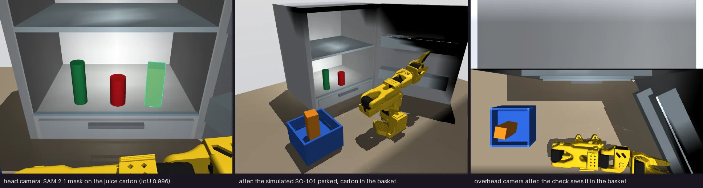

# Hasami (鋏)

**“Bring me the juice from the fridge.”** Hasami joins a Thenar Walker rover, Raspberry Pi controller, six 25 kg·cm digital positional servos and a top camera to a laptop brain. Muse Spark plans from an instruction and image; SAM 3.1 can segment a named object by text; local SAM 2.1 is the point-prompt fallback. The fridge fetch works in MuJoCo. This guide gets a friend through the physical build and states the camera-to-arm and reach work still needed for a real fetch.

> **As of 28 Oct 2026, nothing has run on this physical rover.** The runtime and Walker client have socket tests; the simulation video is not a real run. A human opens the fridge door. Autonomous door opening and navigation are not built.

**Share this guide:** [github.com/nickthelegend/hasami](https://github.com/nickthelegend/hasami). [Live landing](https://hasami-landing.vercel.app) · [recorded simulation evidence](https://hasami-landing.vercel.app/evidence.html).

**Build in this order:** [parts](#1-bill-of-materials) → [assembly](#2-mechanical-assembly) → [wiring](#3-electrical-and-power) → [Pi setup](#4-raspberry-pi-setup-and-first-boot) → [servo calibration](#5-calibrate-all-six-new-servos) → [laptop commands](#6-run-hasami-on-a-laptop) → [Meta integration](#7-meta-models-and-apis). Then follow the [friend checklist](#8-friend-checklist), [recording plan](#9-record-a-truthful-3-minute-video) and [submission checklist](#10-submission).

## Build status

| Piece | Evidence today | Physical work |
|---|---|---|
| Fridge fetch and benchmark | MuJoCo SO-101 with SAM 2.1: 30/30 clean simulated fetches; 146/160 benchmark tasks. Details below. | Keep every result labelled simulation. |
| Pi runtime / Walker client | `thenar_pi` + `hasami_walker` tested over sockets with recording stand-ins; `look` tested with actual SAM 2.1 weights. | Wire and test Pi, motors, arm and camera. |
| Muse Spark / SAM 3.1 | Clients written; no verified live Meta call without `MODEL_API_KEY`. | Test account, request, response and real mask. |
| Real fetch | Camera-to-arm transform, real reach/grasp and single-camera verification **not built yet**. | Build and validate before claiming a hardware fetch. |

## 1. Bill of materials

Reuse the existing Thenar Walker where possible. Its [current brief](https://github.com/nickthelegend/thenar-walker/blob/main/CLAUDE.md) says **240 × 138 mm tub, 3 mm wooden deck, local 370 motors with 6 mm shafts, and flat TPU tyre strips**. The older [BOM](https://github.com/nickthelegend/thenar-walker/blob/main/docs/BOM.md) and [assembly guide](https://github.com/nickthelegend/thenar-walker/blob/main/docs/ASSEMBLY.md) still say 4 mm D shafts, printed deck, ESP32, MG996Rs and a 10 A servo buck. Those are **not this Pi/25 kg build**. Measure the robot in hand. All prices below are budget estimates, before shipping; confirm the current product, price and stock with the supplier before ordering.

| Part | Qty | Purchase / fit check | ₹ guide |
|---|---:|---|---:|
| Thenar chassis, four motors/wheels, PETG/TPU prints, battery cage, fasteners | 1 set | [Print plates/settings](https://github.com/nickthelegend/thenar-walker/blob/main/cad/print/PRINT.md); use the **6 mm shaft** wheel variant for the current motors. New motor buyers: do [the bottle torque test](https://github.com/nickthelegend/thenar-walker/blob/main/docs/ASSEMBLY.md) on one before ordering four. [The Engineer Store 25GA](https://www.theengineerstore.in/products/25ga-370-12v-60rpm-dc-gear-motor) is a different footprint, not a drop-in for the current 6 mm motors. | ₹2,000–4,000 estimate, printing extra |
| **25 kg·cm, 3-wire positional** digital servos | 6 + spare | Confirm label, 180°/270° variant, voltage and horn spline. [Robu DS3225-class 180°](https://robu.in/product/pro-range-ds3225-25kgcm-metal-gear-digital-servo-motor-180-degree/) listed ~₹1,409 each; [Kitsguru options](https://kitsguru.com/collections/servo-motors) vary in travel. Avoid continuous-rotation parts. | ~₹8,454 for six |
| R3 arm prints, matching metal disc horns, screws | 1 set | [thenar-arms R3](https://github.com/nickthelegend/thenar-arms); old horn is **25T Ø20 mm, four M3 on 14 mm PCD**. Check new spline, centre screw and link clearance. PETG parts from the R3 print list; M3×8 horn, M3×12 tabs/nuts/washers, four M3×20 base bolts. | ₹1,000–2,000 estimate, printing extra |
| Pi 4/5, microSD, cooler | 1 | Verify model with `cat /proc/device-tree/model`. [Robu Pi 5 4 GB](https://robu.in/product-category/raspberry-pi-5/) listed ₹13,409. | listing + accessories |
| Camera Module 3 / 3 Wide and correct CSI ribbon | 1 | CSI preferred; Wide helps include shelf and jaws, but check object pixel size/distortion. [Robu camera listings](https://robu.in/product-category/raspberry-pi-displays/) show Wide ~₹4,173. USB webcam also supported. | ₹2,000–4,200 estimate |
| PCA9685, Cytron MDD10A | 1 each | [Robu PCA9685](https://robu.in/product-tag/pca9685/) ~₹249; MDD10A is on the Walker. | ~₹249 + existing driver |
| Servo DC-DC **6.0 V, ≥20 A continuous**; Pi DC-DC **5.0 V, 5 A** | 1 each | Regulators must accept the full 3S battery range and dissipate heat at load. Old 10 A servo buck is undersized. Proper USB-C output for Pi. | ₹1,500–3,500 estimate |
| 3S LiPo/XT60, balance charger, DC-rated KCD4 kill, fuse, insulated distribution blocks, wiring | 1 set | Reuse battery if healthy; 14–16 AWG battery/main wire, 16–18 AWG servo feed, short individual servo leads, heat-shrink/strain relief; 1,000–2,200 µF ≥10 V low-ESR capacitor. | ₹1,500–3,000 estimate if not owned |
| Optional ADS1115, 100 kΩ/27 kΩ resistors, LED/330 Ω | 1 each | I²C battery sense at 0x48; no ADC means “-- V”. [Robu ADS1115 search](https://robu.in/search/?q=ADS1115). | ~₹350 ADC estimate |

Also bring calipers, meter, soldering iron, hex keys, M3 drill/tap, wheel stand, and a small object narrower than the *measured* jaws.

**Servo facts and fit.** The [DS3225 manufacturer sheet](https://dsservo.com/d_file/DS3225%20datasheet.pdf) gives 40 × 20 × 40.5 mm, 60 g, 4.8–6.8 V, **1.9 A stall at 5 V / 2.3 A at 6.8 V**, **4–5 mA idle**, 500–2500 µs pulses, 3 µs deadband, and **180° or 270°** versions. [TowerPro MG996R](https://towerpro.com.tw/product/mg996R/) is 40.7 × 19.7 × 42.9 mm, 55 g. Some [DS3225MG listings](https://iot-robotics.store/shop/ds3225mg-25kg-digital-servo-180-degree-metal-gear/) specify a **25T spline**, matching the tooth count of the old horn, but tooth count alone does not prove a tight fit. Cases are close, but pocket depth, mounting tabs, shaft height, spline and horn screw are **not proven interchangeable**. Dry-fit one of each joint before printing/forcing six. Use the servo’s matching horn if the old 25T horn does not seat/clamp fully; adapt/reprint the link if its Ø20/14 mm PCD face differs. At the nominal 2 ms span, 270° means ~7.4 µs/°, 180° ~11.1 µs/°; **measure each installed joint**. The manufacturer sheet does **not specify moving/running current**; it depends on load, so measure it on the actual arm under motion rather than treating idle current as a design figure. Confirm the friend's actual label and datasheet before wiring 6.0 V.

## 2. Mechanical assembly

1. Print/reuse the tub, cage, wheels and TPU tyres with [Thenar print settings](https://github.com/nickthelegend/thenar-walker/blob/main/cad/print/PRINT.md): PETG 0.20 mm/4 walls/30% gyroid; TPU 95A 0.20 mm/3 walls/20% gyroid. Use the **6 mm shaft wheel variant** for its current local motors. Heat-set four M3 inserts in tub corner columns. Fasten battery cage with two M3×8 and nylocs; put the current motors' M8 collars and 13 mm nuts through the tub wall, leads facing inward. Fit two hard front wheels and rear hubs with flat TPU tyre strips; tighten M3 grubs on the shafts and spin all four by hand. Use the current **250 × 138 × 3 mm wood deck** if reusing the built rover; drill/fasten it to the four corner columns after checking actual holes. [Old assembly order](https://github.com/nickthelegend/thenar-walker/blob/main/docs/ASSEMBLY.md) helps, but its 4 mm shafts, printed deck and ESP32 instructions are stale here.
2. The Walker [BOM](https://github.com/nickthelegend/thenar-walker/blob/main/docs/BOM.md) points to `so101-mg996r/R3-PRINT.md` in [thenar-arms](https://github.com/nickthelegend/thenar-arms). Clone that repo on the printing computer and follow its R3 file list and quantities for the base, shoulder, upper arm, forearm, wrist and gripper. **Those MG996R pockets are only a starting shape.** Dry-fit each new servo with calipers. Check tabs, body, horn, centre screw and full link sweep. Modify/print a link if it rubs. Assemble with **horns off or links disconnected for the first calibration pulse**. Position the arm base on the measured deck clear of switch and mast; drill four mounting holes through its base vent slots and fasten with M3×20, washers and nylocs. Optional 4 mm TPU finger pads improve thin-object grip only after measuring the new gripper gap.
3. Print [parametric camera mast](hardware/camera_mount/camera_mount.scad) using its [print note](hardware/camera_mount/README.md). Place it on the **rear/top deck**, clear of arm/switch/battery; inspect underside before drilling M3 deck holes. Bolt through deck with washers/nylocs. Start at ~**100 mm lens height above deck** and tilt downward until **shelf target and gripper jaws share one frame**. This is a measured framing choice, not a calibrated pose. A frame with only the carton cannot support grasp checking.
4. Fasten Camera Module 3 with four **M2** screws/nylocs and set an M3 tilt hinge. The [official drawing](https://datasheets.raspberrypi.com/camera/camera-module-3-standard-mechanical-drawing.pdf) gives a 25 × 23.862 mm board, Ø2.2 mm holes and 21 × 12.5 mm centres; [Raspberry Pi docs](https://www.raspberrypi.com/documentation/accessories/camera.html) say Module 3 and 3 Wide use the same board/hole pattern. Check your physical module before tightening. Route CSI ribbon from its lower connector down the mast back, with a loose hinge loop, soft clamps, no sharp fold and no arm/wheel contact. Power off before seating CSI; Pi 5 needs its matching 22-to-15-pin camera cable.
5. Mount the Pi with cooler airflow, MDD10A on deck bosses, insulated power blocks away from metal dust. Keep high-current and motor wiring apart from CSI/I²C. Add a basket where the arm can reach and camera can verify it; the simulation's position is not measured real geometry.

## 3. Electrical and power

**The Pi directly connects to PCA9685 and MDD10A. There is no ESP32.** This table uses the defaults in [`pi/thenar_pi/config.py`](https://github.com/nickthelegend/thenar-walker/blob/main/pi/thenar_pi/config.py) and [`docs/WIRING_PI.md`](https://github.com/nickthelegend/thenar-walker/blob/main/docs/WIRING_PI.md). BCM is the GPIO name; number at left is the physical 40-pin header. Colour is a suggestion; label both ends.

| Physical pin | BCM / signal | Colour | Destination |
|---:|---|---|---|
| 1 | 3V3 | orange | PCA9685 **VCC logic**, optional ADS1115 VDD |
| 3 | GPIO2 SDA1 | blue | PCA9685 SDA, optional ADS1115 SDA |
| 5 | GPIO3 SCL1 | yellow | PCA9685 SCL, optional ADS1115 SCL |
| 6 | GND | black | PCA GND, MDD10A signal GND, ADC GND and common ground reference |
| 11 | GPIO17 OE | violet | PCA9685 OE (active low: HIGH = servo outputs off) |
| 13 | GPIO27 LED | white | LED anode through 330 Ω; cathode to ground |
| 29 | GPIO5 DIR1 | green | MDD10A DIR1, left motor pair |
| 31 | GPIO6 DIR2 | green/white | MDD10A DIR2, right motor pair |
| 32 | GPIO12 PWM0 | grey | MDD10A PWM1, left pair, 20 kHz hardware PWM |
| 33 | GPIO13 PWM1 | grey/white | MDD10A PWM2, right pair |
| USB-C power socket | 5 V input | red/black | Separate regulated 5.0 V 5 A supply after kill switch |
| CSI camera socket | Camera Module 3 ribbon | ribbon | Top camera; Pi 5 requires matching cable; USB webcam instead uses USB port |

PCA9685 **VCC = Pi 3.3 V logic; V+ = separate 6.0 V servo bus**. MDD10A accepts 3.3 V signals per the [Walker BOM](https://github.com/nickthelegend/thenar-walker/blob/main/docs/BOM.md). PCA channels: **0 J1 pan, 1 J2 shoulder, 2 J3 elbow, 3 J4 wrist flex, 4 J5 wrist roll, 5 J6 gripper**. Split each servo harness: **red and brown/black go straight to rated +/− distribution**, *only signal* to its PCA channel. Connect PCA V+ and GND to bus for reference; do **not** send six-servo current through its small screw terminal, board rail or Pi ground wire. A rated servo distribution board with separate high-current feed is also fine. Check each label for pin order.

```text
3S battery + -- main fuse -- DC-rated KCD4 KILL -- +BUS
3S battery - ----------------------------------- common -BUS
+BUS -> MDD10A B+; -BUS -> MDD10A B- -> motors ch1 LEFT / ch2 RIGHT
+BUS -> 6.0 V, >=20 A buck -> SERVO + block -> six servo red wires
-BUS ----------------------> SERVO - block -> six servo brown/black wires
+BUS -> separate 5.0 V, 5 A buck -> Pi USB-C; return -> -BUS
Pi pin 1 3V3 -> PCA VCC; pin 3 SDA + pin 5 SCL -> PCA [0x40]
Pi pin 11 GPIO17 -> PCA OE; pin 6 GND -> common ground
PCA ch 0..5 SIGNAL only -----------------------> J1..J6 signals
Pi 32/29 PWM1/DIR1 -> MDD10A left; Pi 33/31 PWM2/DIR2 -> right
Optional ADS1115 [0x48]: 3V3/GND/SDA/SCL; AIN0 <- 100k <- battery +
                                      AIN0 -> 27k -> GND (sense after kill)
Top CSI camera ---------------------------------> Pi camera connector
```

The manufacturer sheet gives **6 × 2.3 A = 13.8 A simultaneous stall at 6.8 V**. Choose **≥20 A continuous at regulated 6.0 V** with cooling and wiring margin. Fit a 1,000–2,200 µF ≥10 V capacitor across servo bus near the split, observing polarity. Put a fuse close to the battery before the kill. A **20 A main fuse is a starting choice only if all wire, connector and switch DC ratings support it**; reduce it to the weakest component and use branch protection where practical. The KCD4 must cut MDD10A, servo buck **and Pi buck together**. All returns meet at common distribution. The old 10 A buck/fuse suggestions were for MG996Rs.

Optional battery sense: ADS1115 at **0x48**, powered from **3.3 V**, battery + after kill through 100 kΩ to AIN0 and 27 kΩ from AIN0 to ground (full 3S pack ~2.7 V at ADC). Never connect battery directly to a GPIO. Without ADS1115, battery display is “-- V”; meter the pack.

**Pre-power checklist:** kill OFF, battery unplugged, check +/− for shorts, switch and fuse interrupt + rail, bench-set bucks to 6.0/5.0 V without loads, confirm servo labels allow 6 V, inspect every servo connector, measure PCA VCC 3.3 V versus V+ 6.0 V, check common ground/OE/motor pins, clear arm and lift all wheels. Energise Pi/logic first without servo leads, then servo power without motion, then one servo at a time. Stop immediately for heat, smoke, twitch or voltage collapse.
## 4. Raspberry Pi setup and first boot

Flash **Raspberry Pi OS Bookworm 64-bit** with Raspberry Pi Imager. Configure user, hostname, SSH and temporary internet Wi-Fi before flashing. Attach monitor/keyboard or SSH. **Clone before changing `wlan0` to AP**, since AP setup can drop SSH. [Raspberry Pi’s camera docs](https://www.raspberrypi.com/documentation/accessories/camera-software.html) say Bookworm uses `rpicam-*` apps; use Picamera2, not the old legacy-camera enable switch.

```bash
cat /proc/device-tree/model
sudo apt update
sudo apt install -y git python3-venv python3-picamera2 python3-opencv i2c-tools
sudo raspi-config nonint do_i2c 0
sudo nano /boot/firmware/config.txt
```

Under an `[all]` section, add the following line once (replace an existing `pwm-2chan` line rather than adding a second). Save and exit. This avoids putting the overlay inside a model-specific section at the end of the file; see [Raspberry Pi config.txt documentation](https://www.raspberrypi.com/documentation/computers/config_txt.html).

```ini
dtoverlay=pwm-2chan,pin=12,func=4,pin2=13,func2=4
```

```bash
sudo reboot
```

After reboot check the overlay line occurs **once** in `/boot/firmware/config.txt`. Seat camera ribbon with power off. Check `rpicam-hello --list-cameras`; take `rpicam-still -o /tmp/camera-check.jpg` after mounting. The runtime prefers Picamera2 (CSI), then OpenCV USB index 0; `THENAR_CAMERA=1` changes USB index and `THENAR_CAMERA=off` disables capture.

```bash
cd /opt
sudo git clone https://github.com/nickthelegend/thenar-walker.git
sudo git clone https://github.com/nickthelegend/hasami.git
cd /opt/thenar-walker/pi
sudo python3 -m venv --system-site-packages .venv
sudo .venv/bin/python -m pip install --editable '.[pi]'
sudo i2cdetect -y 1
```

Expect **`40`** (PCA9685), possibly `70` all-call, and `48` only if ADS1115 is fitted. If `40` is absent, stop and fix wiring before motor power. `[pi]` is the actual extra in `pi/pyproject.toml`; system site packages let the venv see apt Picamera2.

**Lift all wheels and keep the arm limp** for first runtime start. It needs root for ports, PWM sysfs and `/var/lib/thenar`.

```bash
cd /opt/thenar-walker/pi
sudo .venv/bin/python -m thenar_pi
```

In another terminal check `curl http://127.0.0.1/health` and `curl --output /tmp/snap.jpg http://127.0.0.1/snap.jpg`. `GET /snap.jpg` takes a fresh JPEG; HTTP 503 “Setup required: no camera” means camera bring-up remains. Ctrl+C stops wheels and makes servos limp. Then install the **shipped** unit:

```bash
sudo cp /opt/thenar-walker/pi/systemd/thenar-pi.service /etc/systemd/system/
sudo systemctl daemon-reload
sudo systemctl enable --now thenar-pi
sudo systemctl status thenar-pi
sudo journalctl -u thenar-pi -f
```

Exit the live log view with Ctrl+C (the systemd service keeps running), then configure Wi-Fi:

```bash
sudo python3 /opt/thenar-walker/pi/tools/setup_ap.py "Thenar Walker"
```

The AP script privately prompts for an 8–63 character WPA2 password. SSID rule: strip spaces, keep first 20 characters, append `_TF`, so **`ThenarWalker_TF`** at **192.168.4.1**. Reconnect to the AP or use console/Ethernet if SSH drops. On the phone join it, turn **mobile data off**, and open **`http://192.168.4.1`**. Page/`snap.jpg` are port **80**; phone WebSocket **81**, calibrator **82**, Hasami brain **83**. The optional `/etc/thenar-pi.env` sets `THENAR_SSID`, `THENAR_CAMERA` or pin overrides for the service; it is local to the Pi. Without `THENAR_SSID` the page display name is the Pi hostname, which may differ from the AP SSID.

On the stand, send a tiny phone forward/turn command. MDD10A channel 1 is **left pair**, channel 2 **right pair**. Check each wheel direction; power off before swapping a motor's leads. The code defaults `SIDE_SIGN=(1,-1)`. Test phone STOP, link timeout and kill switch while wheels remain lifted. GPIO27 status LED blinks while waiting and lights with phone link.

## 5. Calibrate all six new servos

**The MG996R table in old docs and `thenar_pi.armcal.KNOWN` is invalid. Never run `python -m thenar_pi.armcal seed-known` for the 25 kg arm.** Each joint needs two physical reference poses and two safe pulse ends. The runtime needs a complete record to enable all six; Pi saves it at **`/var/lib/thenar/armcal.json`** (or `THENAR_STATE_DIR/armcal.json`). The file is CRC-checked/atomically written. Browser draft is localStorage per browser and origin; **Save to robot** is required.

1. Wheels on stand, no payload, kill reachable, fingers clear. Support the arm so a limp shoulder cannot fall. Remove horns/disconnect links for first neutral pulse; refit near neutral without hitting stops. Open **`http://192.168.4.1/calibrator`**, press **Connect Pi (Wi-Fi)** (WebSocket port **82**), then **ALL SERVOS OFF**.
2. Work **one joint at a time**. Select J6, J5, J4, J1, J3, J2 as the tool suggests. Check that selected PCA channel is the named joint. Choose a conservative start pulse near **1500 µs** and press **Start this joint**. The *first* pulse jumps at full speed even though later raw jogging is rate-limited. Support the link, not the horn.
3. Jog slowly to displayed **Reference A**, press **Set A**; jog to **Reference B**, press **Set B**. References must differ by at least **10°**. Physical cues from the tool: J1 forward then right (edit B to 45° if 90° unreachable); J2 upper arm vertical then 45° forward; J3 straight then L; J4 gripper straight then 45° down; J5 jaws vertical then quarter turn; J6 jaw tips 20 mm then 60 mm. Use square/protractor/ruler and on-screen *logical* angles, not old pulses.
4. The tool computes `k=(Bµs−Aµs)/(qB−qA)`, `us_per_deg=|k|`, `sign=sign(k)`, `zero=Aµs−qA*k`. A **270°** variant usually gives a smaller slope; never copy 180° numbers. Recheck references/horn if it rejects slope outside **3–20 µs/°** or zero outside **500–2500 µs**. Runtime requires zero strictly between safe ends.
5. Jog to each **safe end**, **3–5° before mechanical contact**, pressing **Set safe end here** at both. Stay within **500–2500 µs**. Use **Test / Go to angle / Sweep** only with clear supported arm. If zero is far from ~1200–1800 µs, shift horn one spline tooth and redo. Verify sweep clears deck, mast, cable and other links. Press **Mark joint done**.
6. Repeat all six, then press **Save to robot**. It sends `CAL` then `CALSAVE` and makes all joints limp again. The tool also offers an old `calibration.h` export; **do not use it for the Pi**. Verify:

```bash
cd /opt/thenar-walker/pi
sudo .venv/bin/python -m thenar_pi.armcal show
sudo test -f /var/lib/thenar/armcal.json
```

`mask=3F complete=1` is the finish line. Back up the JSON outside the robot. With arm supported near its target, use phone Arm ON one joint at a time and test tiny motions before any taught pose. Runtime starts limp, slew-limits later target moves to **120°/s**, clamps calibrated ends, stops wheels after **300 ms** link silence and **holds arm with PWM on** so a grasp is not dropped. At 25 kg·cm a wrong horn/first pulse can break plastic or injure fingers; link-loss hold does not replace the physical kill switch.

## 6. Run Hasami on a laptop

The Pi runs the body; the laptop runs `hasami_walker` over the AP. Use Python **3.12**. Windows 11 PowerShell (no batch launcher):

```powershell
git clone https://github.com/nickthelegend/hasami.git
cd hasami
python -m venv .venv
.\.venv\Scripts\python.exe -m pip install -e '.[dev]' -c constraints.txt
```

Linux/macOS:

```bash
git clone https://github.com/nickthelegend/hasami.git
cd hasami
python3.12 -m venv .venv
.venv/bin/python -m pip install -e '.[dev]' -c constraints.txt
```

Below, `python` means the venv Python (`.\.venv\Scripts\python.exe` on Windows; `.venv/bin/python` on Linux/macOS). Join `ThenarWalker_TF`. Default address `192.168.4.1`; `HASAMI_ROBOT` or `--robot` overrides it. Poses live in `~/.hasami/walker_poses.json` unless `HASAMI_WALKER_POSES` is set.

**Prepare while the laptop has internet.** Install packages and download SAM weights before switching Wi-Fi to the robot:

```bash
python -c "from hasami_perception.segment import LocalSam2; LocalSam2(); print('SAM 2.1 ready')"
```

Expected: the first run downloads weights, then prints `SAM 2.1 ready`; later runs use the cache. Meta API calls still need internet **during** the run. Keep a second internet connection on the laptop (for example Ethernet or USB tethering), or put laptop and Pi on the same internet-connected router and use `--robot <pi-address>`. The robot AP alone does not provide upstream internet unless separately configured. Phone mobile data should stay off while using its local controller page.

Get a key from [dev.meta.ai/api-keys](https://dev.meta.ai/api-keys/); put `MODEL_API_KEY=...` in a **git-ignored `.env`** in Hasami. Optional `MODEL_API_BASE_URL=https://api.meta.ai/v1`, `HASAMI_ROBOT=192.168.4.1` and `HF_HOME=...`. **The code does not auto-load `.env`.** Load it into the current shell before running commands. Keep simple values without quotes/spaces. Never commit, print or share the key.

```powershell
Get-Content .env | Where-Object { $_ -match '^[A-Za-z_][A-Za-z0-9_]*=' } | ForEach-Object { $n,$v = $_ -split '=',2; [Environment]::SetEnvironmentVariable($n,$v,'Process') }
```

```bash
set -a
. ./.env
set +a
```

Start with **`python -m hasami_walker status`**: config, calibration, usable joints, round-trip, camera and phone/brain state. Battery value needs ADS1115. After calibration:

| Command | Action / check |
|---|---|
| `python -m hasami_walker snap shelf.jpg` | Save one robot JPEG; inspect shelf, target **and jaws**. Same feed as `GET http://192.168.4.1/snap.jpg`. |
| `python -m hasami_walker teach look_shelf` | Store current six-joint phone-positioned shelf pose on laptop. |
| `python -m hasami_walker teach carry` | Store separately a stable, clear carrying pose after phone positions it. |
| `python -m hasami_walker poses` | List stored poses/file. |
| `python -m hasami_walker go look_shelf` | Move an **already switched-on** arm to taught angles and wait. If limp, hold near target and press phone Arm ON. |
| `python -m hasami_walker look "orange juice" --pose look_shelf --out look.png` | Fresh frame and item outline/centroid; moves **only** optional taught pose, **no reach/grasp**. Without key supply `--point 410,260` or a colour like “orange”. `--image photo.jpg` works without robot. |
| `python -m hasami_walker drive 15 0 0.5` | 15% forward for 0.5 s then zero. **Wheels on stand first.** CLI caps duration to 5 s. |
| `python -m hasami_walker limp` | Turns arm PWM off; support arm/payload. |
| `python -m hasami_walker resume` | A human deliberately clears a phone STOP pause after checking scene. |

Real phone input outranks Hasami for **2 s**; the brain forgets its prior drive stick. **Phone STOP pauses brain until `resume`.** Either link silent for **300 ms** stops wheels while holding arm. Test on stand. The laptop [dashboard](#simulation-and-evidence) at `127.0.0.1:8420` is a **simulation/real-camera lab UI**, not a live Walker fetch dashboard. Do not say its simulated Run button drove the rover.

**Angles are commanded estimates.** These three-wire hobby servos have no position or gripper-force feedback to the Pi. `status`, `teach` and `wait_pose()` report the runtime's commanded/slewed angles; they cannot prove a joint physically arrived or an object was held. Move the arm with the phone while powered before teaching a pose; manually repositioning a limp arm is not measured. The real fetch needs fresh camera verification and external measurements during calibration.

## 7. Meta models and APIs

| Model/API | Hasami job | Implemented / environment | Proof still needed |
|---|---|---|---|
| [SAM 3.1 on Meta Model API](https://dev.meta.ai/docs/sam/overview) | Short text phrase (“orange juice carton”) → matching box/mask in Pi image. | `hasami_perception.segment.MetaSam3` and `hasami_walker.look.find` call `POST /v1/responses`. **`MODEL_API_KEY`**, optional `MODEL_API_BASE_URL`. Written, not live-verified. `meta-sam-parser` is **not a dependency**; absent/mismatched decoder means this `look` path cannot yet return a SAM 3.1 mask. With a key set, `look` does **not** automatically fall back to a point after a SAM 3.1 decode error; unset `MODEL_API_KEY` in that shell to use local SAM 2.1. Simulation grounding can use a SAM 3.1 box and local SAM 2.1. | With key, verify real response, decode actual mask, overlay on `snap.jpg` and time it. |
| [Muse Spark 1.3](https://dev.meta.ai/models/muse-spark) | Instruction + image → validated named pick/place plan with pixel hints. | `hasami_planner.muse.Planner` uses `muse-spark-1.3` and forced `submit_plan`. **`MODEL_API_KEY`**, optional `MODEL_API_BASE_URL` and `HASAMI_PLANNER_MODEL`. Only simulation invokes this planner; live call unverified. | Validate real tool output and then connect to guarded real fetch after reach exists. |
| [SAM 2.1 open weights](https://ai.meta.com/research/sam2/) | Local point/box mask after click or colour-selected point; fallback without Meta key. | `LocalSam2` in `segment.py`, `look.find` and simulated fetch. No API key. `HF_HOME` selects download/cache. Actual weights exercised in sim and `look` tests. | Check real mask in real `snap.jpg`. First download needs internet and ~150 MB. |
| [Llama 4 Scout vision](https://dev.meta.ai/llama/docs/model-cards-and-prompt-formats/llama4) | Optional independent frame check: is target still on shelf, or held in jaws? Its text judgment must not bypass geometry/safety gates. | **Not wired.** No Hasami env var. Model/hosting choice and access are separate; do not assume `MODEL_API_KEY` grants it on Model API. | If time, choose available provider, use new git-ignored key variable, compare against filmed frames. Muse already accepts images; prioritise a reliable checker. |
| [Meta DINOv3](https://ai.meta.com/research/dinov3/) | Candidate dense vision/depth **backbone** for shelf geometry from a monocular RGB camera. | **Not wired.** Open weights; no existing env var. Requires adapter, scale calibration and laptop/Pi performance check. | Validate *metric* distance against a ruler before permitting reach. Raw DINOv3 features are not a depth sensor. |
| [Muse Voice Transcribe](https://dev.meta.ai/docs/overview#build-with-muse-voice-transcribe) | Optional spoken request → text for the planner. | **Not wired.** Documented model `muse-voice-transcribe-1.0`; no microphone/transcription client in Hasami. | Add push-to-talk, show the transcript for confirmation, and use the existing key only after account access is checked. |

**SAM decoder task:** current Python `_decode_mask()` in `packages/perception/hasami_perception/segment.py` assumes an unverified `meta_sam_parser` interface. The [current official SAM guide](https://dev.meta.ai/docs/sam/overview) documents the JavaScript package **`@meta-sam/parser`** (`decodeMaskToRaster`). Adding a similarly named Python package is not a verified fix. Implement a compatible decoder or a small bridge to the official parser; test mask dimensions, offsets and a real response against the input image before claiming SAM 3.1 masks work.

The Camera Module 3 supplies **RGB, not metric depth**. The sim’s perfect depth and overhead basket camera do not exist on this rover. More model calls cannot replace camera-to-arm calibration. Use SAM 2.1 for bring-up, then Meta API when the key and response format work. [Meta Model API docs](https://dev.meta.ai/docs/overview) confirm base `https://api.meta.ai/v1` and key; check Nick’s account access/billing.

## 8. Friend checklist

- [ ] **Inventory/fit.** Read each servo label, confirm 3-wire positional, voltage, travel and spline; dry-fit every pocket/horn. **Done when:** joints sweep by hand without binding.
- [ ] **Assemble body/mast.** Check wheel-shaft variant and CSI ribbon loop. **Done when:** all wheels spin freely and mast frames target and jaws together.
- [ ] **Wire/meter power.** Replace 10 A buck, add fuse, kill, distribution, common ground. **Done when:** switch cuts *all* rails; unloaded bucks read 6.0 and 5.0 V.
- [ ] **Bring up Pi.** Install OS, I²C/PWM/camera/runtime/AP. **Done when:** `i2cdetect -y 1` shows `40`, `/health` reports camera, `/snap.jpg` saves real image and phone page opens.
- [ ] **Test wheels on stand.** Confirm side/direction, phone STOP, silence/kill. **Done when:** tiny command turns intended side and silence stops both sides.
- [ ] **Calibrate six servos.** Two references, two safe ends, Save to robot. **Done when:** `armcal show` says `mask=3F complete=1` and tiny commanded moves go the right way.
- [ ] **Teach/look.** Teach `look_shelf`/`carry`, `snap`, local `look`, then key-backed SAM 3.1. **Done when:** a fresh real frame shows the right mask and arm/camera clearances.
- [ ] **Finish Meta mask decoding and live planning.** Resolve the parser task above, keep internet alongside the robot connection, and validate Muse's actual output. **Done when:** a real image produces a correctly aligned SAM 3.1 mask and a schema-valid Muse plan; record model IDs and timings without secrets.
- [ ] **Build camera-to-arm calibration and real reach — not built yet.** Add a real-robot module beside `packages/walker/hasami_walker/look.py`, e.g. `reach.py` with `calibrate_camera_to_arm()` and `plan_reach()`. Measure camera intrinsics/distortion, camera-to-arm 3D correspondences (fiducial/ruler), object depth/scale and uncertainty. Add a guarded `packages/walker/hasami_walker/fetch.py:fetch()` that calls `look.find()`, rejects poor mask/scale/jaw fit/out-of-reach/colliding targets, plans approach, grasp, withdrawal and delivery, then sends only checked targets through `Walker.pose()/wait_pose()` in `client.py`. `packages/core/hasami_core/fetch.py:FridgeFetch._attempt()` and sim `Arm.plan_front()/fetch_front()` are **MuJoCo examples**, not hardware commands. Design new verification from the single top camera; the sim’s overhead basket check is absent. **Done when:** no-payload target at several measured shelf positions is reached within measured tolerance at low speed, failures stop safely, then actual grasp/release is verified in fresh frames.
- [ ] **Film a live task.** A person opens the fridge; attempt only after guarded reach passes. **Done when:** uninterrupted filmed real detection, grasp, carry and release, or a truthful statement of the last manual step.
- [ ] **Submit.** Check public URLs/form. **Done when:** accepted before deadline.

## 9. Record a truthful ~3-minute video

Use **live real runs only: no replays and no edited robot output; captions are allowed.** Keep the fetch uncut in a continuous wide camera view and capture the live screen at the same time. The current dashboard is a *sim/lab* dashboard. If a live Walker dashboard is not built, show `snap.jpg`, `look.png` and CLI output with timestamps, labelling the sim dashboard separately. Never overlay a simulated mask on real video.

| Time | Shot and line |
|---|---|
| 0:00–0:20 | Wide person/open fridge/rover. “A shelf pickup needs the robot to find, grasp and check an item.” State that a person opens the door. |
| 0:20–0:45 | Show top camera, Pi, power kill, phone. “Thenar Walker body, Pi, six newly calibrated 25 kg servos.” |
| 0:45–1:45 | **Continuous live attempt** from shelf view through grasp/carry, only if reach is implemented. Show live feed, SAM mask, model name and timestamps on screen. |
| 1:45–2:10 | Phone safety override: low-speed command in safe space/on stand, phone STOP, brain pause, deliberate `resume`. |
| 2:10–2:40 | Show result/fresh-frame verification; briefly label simulation benchmark/evidence as **simulation**. State whether Muse, SAM 3.1 or local SAM 2.1 actually ran. |
| 2:40–3:00 | State exactly what ran on hardware and remaining reach/depth/verification work; show repo. |

Use one wide angle including rover, arm, shelf and operator; a close angle may show jaws but cannot conceal the wide live run. Screen capture the product UI or terminal beside the camera feed. Light fridge shelf from the side to avoid a dark gripper and blown-out cartons; check focus, audio, battery, disk and timestamps. **Retake plan:** keep a failed take as evidence, explain it, reset visibly and start a separately labelled attempt; never splice two tries into a single “success.” Large MP4s go in a GitHub Release or public video host, **not git**.

## 10. Submission

Deadline: **Nov 4 2026, 9 PM ET = Nov 5 2026, 07:30 IST** (Indie track). Hasami is Nick’s only entry. Check [submission form draft](HACKATHON_SUBMISSION_FORM.md) against the actual submission site: its older “video not recorded” and pre-event text need factual updates before sending. Provide public [repo](https://github.com/nickthelegend/hasami), public live demo video URL, accurate description and Meta models **actually called**. Check event work with `git log --format='%h %cI %s' pre-event-2026-10-25..main`: commits after that tag should be dated **Oct 26 or later**. Do not re-label pre-event evidence. Confirm current official video/edit and eligibility rules on the [event page](https://cerebralvalley.ai/e/meta-ai-developer-hackathon).

The live, uncut recording requirements above are this project's recording standard. The public event page confirms the deadline but does not publish those detailed video rules; check the accepted-participant portal for the binding submission format and eligibility requirements.

- [ ] Public repository opens while signed out; README matches the filmed hardware and code.
- [ ] Public video link plays without an access request; every simulation sequence is labelled.
- [ ] Submission form reports only models actually called and hardware actually demonstrated.
- [ ] Pre-event baseline and event work are disclosed accurately; review the event commit range.
- [ ] Submit through the participant portal before the deadline; save the confirmation/receipt.

**Project provenance:** Hasami started on Oct 20. The simulation, benchmark, dashboard and digital-twin foundation predate the event; `pre-event-2026-10-25` is the baseline for identifying later work. The repository preserves that history. This guide does not establish whether pre-existing work is eligible; use the organizer's rules and disclose it in the submission.

## 11. Safety and troubleshooting

**Safety:** Accessible, DC-rated KCD4 kill must cut all power. Lift wheels for first tests. A 25 kg servo can crush fingers/snap prints; keep hands clear, support limp arm, and treat Arm ON’s first pulse as full speed. No unattended arm or occupied fridge. Charge 3S LiPo with a balance charger, inspect swelling/damage, prevent shorts, and store/transport safely. Use an object narrower than measured jaw opening; the simulated 32 mm carton is not a retail carton.

| Symptom | Check |
|---|---|
| `i2cdetect -y 1` lacks `40` | I²C enabled/rebooted? Pin 1 3.3 V to VCC, 3 SDA, 5 SCL, 6 GND? Check address jumpers/shorts; keep V+ separate. |
| Pi brown-out/reset on servo motion | Meter Pi 5 V and servo 6 V under load; separate 5 V 5 A supply, ≥20 A servo supply, capacitor, short/heavy leads, buck cooling/common ground. |
| Jitter, jump, reversed joint | Confirm variant/power/horn, redo two-reference calibration/safe ends; swap servo between channels to isolate bad servo vs PCA channel. First pulse is **not** slew-limited. |
| Wrong wheel direction | Wheels on stand; MDD10A ch1 left/ch2 right; check lead polarity and `SIDE_SIGN=(1,-1)`; kill before rewiring. |
| No camera / `/snap.jpg` 503 | `rpicam-hello --list-cameras`, reseat CSI with power off, check Pi 5 cable; for USB check `/dev/video*`/`THENAR_CAMERA`. Runtime tries CSI then USB. |
| “Setup required” | `MODEL_API_KEY` missing for Meta, no camera for snap, or no valid arm calibration for Arm ON. `.env` is **not auto-loaded**. |
| First SAM 2.1 look slow | First use downloads `facebook/sam2.1-hiera-tiny` to `HF_HOME`/Hugging Face cache (~150 MB); give laptop internet before joining the AP. |
| Page works, brain does not | Laptop on AP? `status` uses port 83; phone 81, calibrator 82. Check `journalctl -u thenar-pi -f` and `/health`. |
| Calibration “lost” | Browser localStorage is per origin/port; return to `http://192.168.4.1/calibrator` and **Save to robot**. Check `armcal show`. |

## Simulation and evidence

Everything below is measured **MuJoCo simulation** or its dashboard. Its SO-101, perfect depth and overhead camera are not measurements on the Pi rover.

## Fridge fetch (simulated)



*Recorded run `20261026T111544704Z` ("bring me the juice from the fridge", layout 0), frames as stored
(captions added): the head camera with SAM 2.1's mask, the three-quarter view after, the overhead frame the
check used.*

**"Bring me the juice from the fridge": the simulated SO-101 takes the carton off the shelf from the front
and puts it in its basket.** The robot this is for is the owner's Thenar Walker, a wheeled base carrying an
SO-ARM100-family 6-DoF arm. It is not wired yet, so this is the MuJoCo SO-101 standing in front of an open
fridge. Nothing here has moved a real arm, and the base does not drive.

```bash
python scripts/run_fetch.py "the juice carton"   # or "bring me the juice from the fridge"; --seed N layout, --no-video
python scripts/fetch_sweep.py --seeds 10         # every item on 10 layouts -> deployments/fetch/<UTC>.json
```

- **The fridge** (`hasami_sim.scene.fridge_scene`, built with MjSpec like the tabletop scenes): the item shelf
  is 55 mm above the plane the arm stands on (the drawer under it is closed), with an upper shelf, walls, back,
  ceiling, and the door swung open 115° beside the robot. On the shelf, 45 mm behind its front edge: a juice
  carton (orange, 32 × 32 × 80 mm), a can (red, Ø30 × 56 mm) and a bottle (green, Ø26 × 85 mm). The seed
  shuffles their order and moves each by a few millimetres (the carton also turns up to ±15°). They are scaled
  to the SO-101's 41 mm jaw opening; a real can is 66 mm across. The robot's blue basket stands on a 40 mm
  riser beside the arm.
- **Seeing into it.** The overhead camera cannot (the fridge's top hides the shelf), so a head camera on a mast
  behind the arm looks in. From its RGB + depth: the shelf is the largest level surface in reach, the things
  on it are the pixels raised above it, SAM 2.1 segments each from a point prompt with its box, and each mask
  is measured from the front: width across the view, height, colour, and the centre half a width behind the
  nearest surface. The named item's entry (colour, height ±8 mm, width ±5 mm) picks which one; if nothing
  passes, nothing moves. The basket is found in the overhead frame by its colour and SAM 2.1, as the tray is.
- **In from the front, not from above.** `Arm.plan_front` tries gripper tilts from 15° to 40° below level and
  keeps the flattest at which every pose of the fetch has an IK solution. The jaws stay level and close on the
  item's sides 70 % of the way up, so it hangs below the jaw axis instead of balancing on it. In, close, lift
  12 mm, slide back out past the cabinet's front corners, swing round on an arc, lower into the basket, open,
  rise. The tabletop's top-down picks are unchanged: the benchmark rerun on seeds 0-2 (24 tasks, 8 families)
  matched the committed clean sheet task for task.
- **Muse.** With `MODEL_API_KEY` set, the existing planner reads the sentence and the head-camera frame and
  names the item (and points at it). Without the key the run prints `Setup required: MODEL_API_KEY` and uses
  the item you named, matched by its words ("juice" → the juice carton). Muse has not been called (no key), so
  every number here is the named-item path.
- **Check and retry**, as on the tabletop: the gripper's reading after closing, after the withdrawal and over
  the basket; the head camera (is it still on the shelf?); the overhead camera (is a raised thing of its
  colour in the basket, its top where the item's top should be?). A failed check surveys the shelf again from
  a new frame and retries, up to twice.

Simulated, SAM 2.1 hiera-tiny, the item named directly; about 4 s per fetch on this Mac's CPU without video:

| Sweep | Juice carton | Can | Bottle | Retries | Check agrees |
|---|---:|---:|---:|---:|---:|
| Clean, layouts 0-9 ([`110634Z`](deployments/fetch/20261026T110634Z.json)) | **10/10** | **10/10** | **10/10** | 0 | 30/30 |
| First grasp 40 mm short, layouts 0-4 ([`111011Z`](deployments/fetch/20261026T111011Z.json)) | 5/5 | 5/5 | 5/5 | 15 | 30/30 |
| First grasp 30 mm short, layouts 0-4 ([`110816Z`](deployments/fetch/20261026T110816Z.json)) | **1/5** | 5/5 | 5/5 | 15 | 26/26 |

Every item that reached the basket was upright. Clean sweep: mask IoU 0.991 mean (min 0.986), located
centre 0.38 mm from the true one on average (max 0.68 mm), tilt 15° (20° on one layout). "Short" is a
labelled injected fault (`HASAMI_DISTURB=short_mm:30`): the first grasp stops that far in front of the item
and the jaws close on air. The gripper reading caught it every time and the retry fetched the item. What
fails: at 30 mm short, the closing jaws knocked the carton over 4 times in 5. The new survey then sees an
orange thing 79-101 mm wide, no carton, and the robot stops instead of grabbing it; a fallen item is not
handled.

Limits of this demo: simulation only, one fridge; the door is already open and the arm already in front of
it (no driving, no door opening); perfect depth and an exactly known head-camera pose; the basket check uses
the sim's overhead camera, which the real robot does not have; items scaled to the SO-101's jaws.

## Benchmark

`scripts/bench.py` runs seeded task families and checks each goal against the physics state. Planner:
**simulated-click planner** (an oracle: it knows which object each step moves and clicks the middle of its
colour blob in the rendered image; it is not a language model, so this measures perception, grasping,
placing and recovery, not planning). Segmenter: SAM 2.1 hiera-tiny, local. Up to 2 retries per step.
Eight families: all-to-tray, sort-by-colour, stack-two, clear-except-X, tower-of-3, **sort-by-shape**
(cylinders to the tray, cubes to the bin, the rest stay), **line-up** (three cubes in a row on the table,
smallest to largest, left to right), **pick-from-bin** (take the named object out of a bin of three).

Every pick target is checked before the arm moves (`hasami_perception.plausible`). The narrow side must fit
the open jaws (41 mm). The long side must be within the scene's object sizes, allowing for an object
lying down or leaning on an edge. The top must be at an object's height, the centre inside the reach
annulus or a container, and the mask must not run off the frame. A target that fails gets SAM 2.1 again
with a box (from the step's last good mask, or one object-size around the pixel). Then the colour the label
names, or a raised blob, is searched near the pixel, and each candidate is checked again, colour included.
If nothing passes, the step is **skipped as `implausible`** and the arm is not moved.

Clean, 20 seeds per family ([`20261021T173703Z.json`](deployments/bench/20261021T173703Z.json), with the check):

| Family | Planner | Tasks solved | Steps placed | Failures (segment / implausible / grasp / place / goal) | Retries | Check agrees |
|---|---|---:|---:|---|---:|---:|
| all-to-tray | simulated-click planner | **20/20** | 60/60 | 0 / 0 / 0 / 0 / 0 | 0 | 60/60 |
| sort-by-colour | simulated-click planner | **20/20** | 62/62 | 0 / 0 / 0 / 0 / 0 | 0 | 62/62 |
| stack-two | simulated-click planner | **20/20** | 20/20 | 0 / 0 / 0 / 0 / 0 | 0 | 20/20 |
| clear-except-X | simulated-click planner | **20/20** | 60/60 | 0 / 0 / 0 / 0 / 0 | 0 | 60/60 |
| tower-of-3 | simulated-click planner | **12/20** | 37/40 | 0 / 2 / 1 / 0 / 5 | 14 | 52/52 |
| sort-by-shape | simulated-click planner | **20/20** | 59/59 | 0 / 0 / 0 / 0 / 0 | 0 | 59/59 |
| line-up | simulated-click planner | **20/20** | 60/60 | 0 / 0 / 0 / 0 / 0 | 0 | 60/60 |
| pick-from-bin | simulated-click planner | **14/20** | 16/20 | 0 / 0 / 4 / 0 / 2 | 9 | 29/29 |
| **all** | | **146/160** | 374/381 | | 23 | 402/402 |

Failure classes: **segment** (the mask, or the object it led to, was wrong), **implausible** (skipped
before any move: no located target passed the check), **grasp** (the jaws never held it), **place** (held
but did not end up at the target), **goal** (every step passed its check but the final arrangement did not,
e.g. a stack shifted). *Check agrees*: how often the robot's own check (gripper position + camera) matched
the physics outcome. What fails: towers of three (seeds 10-19 are harder than 0-9, where 9/10 pass: five
stacks shift after every step passed), and picking out of the bin (four grasps stop on the way down, the
jaws meeting the bin's wall or a neighbour; twice a neighbour is dragged).

### Before and after the target check (same seeds, same commands)

| Sweep | Before: tasks | After: tasks | Before: failures | After: failures | Retries | Skipped as implausible | Check agrees |
|---|---:|---:|---|---|---:|---:|---:|
| Clean, seeds 0-19 | 146/160 | 146/160 | segment 1, grasp 6, goal 7 | implausible 2, grasp 5, goal 7 | 25 → 23 | 2 steps | 406/406 → 402/402 |
| Scripted plan, hints 20 px off, seeds 0-9 | 76/80 | 76/80 | grasp 3, goal 1 | implausible 1, grasp 2, goal 1 | 9 → 8 | 1 step | 198/198 → 196/196 |
| Noisy camera, seeds 0-9 | 63/80 | **64/80** | segment 12, grasp 5 | segment 3, implausible 11, grasp 2 | 51 → 35 | 18 steps | 237/240 → 201/206 |
| Grasp offset + slips, seeds 0-7 | 41/64 | 41/64 | grasp 13, segment 7, goal 2, place 1 | implausible 10, grasp 9, goal 2, segment 1, place 1 | 184 → 172 | 13 steps | 331/331 → 307/307 |

Files, before → after: clean [`165535Z`](deployments/bench/20261021T165535Z.json) →
[`173703Z`](deployments/bench/20261021T173703Z.json); scripted [`170448Z`](deployments/bench/20261021T170448Z.json) →
[`174610Z`](deployments/bench/20261021T174610Z.json); noisy [`170928Z`](deployments/bench/20261021T170928Z.json) →
[`175048Z`](deployments/bench/20261021T175048Z.json); grasp faults [`171443Z`](deployments/bench/20261021T171443Z.json) →
[`175539Z`](deployments/bench/20261021T175539Z.json). Before = b1d6bfa, after = with the target check.

Per family, after (tasks solved; before in brackets where it changed):

| Family | Scripted plan, hints 20 px off | Noisy camera | Grasp offset + slips |
|---|---:|---:|---:|
| all-to-tray | 10/10 | 10/10 | 7/8 |
| sort-by-colour | 10/10 | 6/10 | 6/8 |
| stack-two | 10/10 | 9/10 | 7/8 |
| clear-except-X | 10/10 | 6/10 | 4/8 |
| tower-of-3 | 9/10 | 8/10 | 5/8 |
| sort-by-shape | 10/10 | **6/10** (5/10) | 0/8 |
| line-up | 10/10 | 10/10 | 7/8 |
| pick-from-bin | 7/10 | 9/10 | 5/8 |
| **all** | **76/80**, 8 retries | **64/80** (63/80), 35 retries | **41/64**, 172 retries |

What changed, honestly:

- **The arm is no longer sent to things that are not objects.** Before, the noisy-camera sweep had 24 step
  records where the arm aimed more than 100 mm off (IK residual over 100 mm, or a localisation error over
  50 mm), and the grasp-fault sweep had 13. After, the noisy sweep has none. The grasp-fault sweep has one,
  a lift that stalled on a correctly located cylinder (0.8 mm off), which is not a leak.
- **It mostly relabels losses; it rarely turns them into wins.** Most of the noisy-camera segment losses
  are now `implausible`. In those cases the object had already left the pick pixel: a tipped cylinder fell
  into the tray, rolled off, or a cube fell off a tower. So the boxed re-prompt and the colour search find
  nothing of the right colour nearby, and the step is skipped rather than flown to the table's middle.
  Skipping costs fewer retries (51 → 35) and saved one sort-by-shape task. The bench JSON records only each
  step's final outcome. A step the fallback rescued shows up as a placed step, so the sweeps do not count
  rescues on their own; `tests/test_plausible.py` runs both rescue paths on demand.
- **Some skips are real objects out of reach:** a cube or cylinder knocked to 84-103 mm from the base axis
  (inside the base's dead zone; the reach annulus starts at 160 mm), or out to 293-298 mm. The old code
  tried those and stopped in the air; now they count as `implausible`, not `grasp`.
- **Still open:** three noisy-camera `segment` losses where SAM's plausible mask was the wrong object
  (right size, wrong one), and the check disagreeing with physics 5 times in the noisy sweep (all "image
  says failed, physics says placed"; 3 before).
- Fewer checks after (e.g. 406 → 402): a skipped attempt never moves, so it has no image check.

The sweeps, unchanged from the last pass:

- **Scripted plan** (`--planner scripted --hint-px 20`): each task's plan written by code in the Muse
  format, the object named by colour and shape and its hint pixel moved 20 px in a random direction, so the
  grounding layer has to find it. It is not a language model either.
- **Noisy camera** (`HASAMI_DISTURB=depth_mm:2,cam_mm:3,light:0.3`): 2 mm Gaussian noise on every depth
  pixel, the camera's believed position 3 mm off, lighting brightness ±30 % with a tint.
- **Grasp offset + slips** (`HASAMI_DISTURB=offset_mm:6,slip:0.2`): every first grasp aimed 6 mm off so
  the fixed finger lands on the object, 20 % of grips let go after the lift. What is lost is the
  disturbance's own damage, worst for 40 mm cylinders, which the misaimed finger knocks over (sort-by-shape
  0/8).

Over the four new files the robot's own check matched the physics in 1106 of 1111 checks (1172 of 1175
before). Earlier results are kept: the four pre-check files above, and the five-family files
[`052238Z`](deployments/bench/20261021T052238Z.json), [`052444Z`](deployments/bench/20261021T052444Z.json),
[`052717Z`](deployments/bench/20261021T052717Z.json).

Reproduce:

```bash
python scripts/bench.py --family all --seeds 20
python scripts/bench.py --family all --seeds 10 --planner scripted --hint-px 20
HASAMI_DISTURB=depth_mm:2,cam_mm:3,light:0.3 python scripts/bench.py --family all --seeds 10
HASAMI_DISTURB=offset_mm:6,slip:0.2 python scripts/bench.py --family all --seeds 8
python scripts/bench.py --family all --seeds 5 --planner muse                # needs MODEL_API_KEY
```

The Muse planner has not been benchmarked: no key yet (`--planner muse` prints
`Setup required: MODEL_API_KEY` and writes nothing).

## Your desk, twinned

**Digital twin from one photo · simulated arm.** Photograph a desk with an A4 sheet on it. The sheet gives
the table plane and the camera's pose; SAM 2.1, prompted at a grid of points on the plane, finds every
object; each mask is fitted as an upright box or cylinder whose projected silhouette matches it (height
estimated from the silhouette, or typed); MuJoCo builds the scene with the SO-101 beside the sheet and
renders it from the photo's own viewpoint. Then the simulated arm runs a task on the twin (clear the desk,
sort by colour, stack two) with the same grounding, checks and retries, scored by the same goal predicates.


*Left: a synthetic photo (MuJoCo render), not a real one. Right: its twin.* Measured on 20 such photos
(`scripts/twin_accuracy.py --seeds 20 --tasks`, [`accuracy-20261021T164701Z.json`](deployments/twins/accuracy-20261021T164701Z.json)),
only the RGB image given to the pipeline:

| | True field of view | Assumed 70° (a real photo's default) |
|---|---:|---:|
| Objects found / false positives | **86/86** / 0 | 83/86 / 1 |
| Shape (box vs cylinder) / colour right | 83/86 / 86/86 | 83/83 / 83/83 |
| Centre error, mean / max | **1.2 / 4.9 mm** | 3.3 / 14.3 mm |
| Yaw error, median / max | 0.35° / 22° | 0.57° / 3.5° |
| Height error, mean / median / max | **1.6** / 0.9 / 13.7 mm | 2.8 / 1.7 / 17.7 mm |
| clear-desk on the twin (simulated-click planner) | **16/20** goals met | — |

`POST /api/twin` (photo body), the dashboard's **Twin** tab (upload, or "Try a synthetic photo"), and
`GET /api/twin/sample.png` for a rendered test photo. Limits: tested on rendered photos only (a real desk
photo is pending); white objects on the sheet and objects the colour of the table are missed; an object over
a sheet corner needs the corners clicked; the field of view is assumed unless known. Method:
[`packages/docs`](packages/docs/README.md#your-desk-twinned-digital-twin-from-one-photo--simulated-arm).

## Pipeline

```
"put the red things in the tray and the blue things in the grey bin"
   │  Muse (muse-spark-1.3, image + instruction) ── plan: pick "red cube" @ hint (u,v), place "tray" @ (u,v)
   │  [waits for MODEL_API_KEY: never called; the image + forced-tool call is unverified until then.
   │   Today a clicked plan, the simulated-click oracle or a scripted Muse-format plan enters here]
   ▼
grounding: SAM 2.1 at the hint ─ check size, distance, raised, colour ─ else colour blob ─ else raised blob
           (or SAM 3.1 on the Meta Model API by name, validated the same way: also waits for the key)
   ▼
mask + metric depth ── centre, top height, yaw, footprint (square / elongated / round) ── grasp axis + width
   ▼
SO-101 in MuJoCo: closed-loop IK above → descend → close → lift → carry → lower to measured surface → open
   ▼
check: gripper position (held?) + camera (pick spot clear? object at the place spot?) ── fail → re-find, retry ≤ 2
   ▼
score (not used by the robot): physics state, goal predicate
   (optional mirror mode: a LeRobot follower repeats the joint targets; wired, never run on hardware)
```

## What is real, what is waiting

| Part | State |
|---|---|
| Arm | The official SO-101 MuJoCo model (TheRobotStudio, Apache-2.0) with force-limited STS3215 position servos. A pick only counts if the jaws physically hold the object. |
| Camera | Simulated overhead RGB + metric depth. Ground-truth segmentation scores perception; it is never an input. |
| SAM 2.1 | `facebook/sam2.1-hiera-tiny`, open weights, on this Mac. Every number here comes from it. |
| Grasp + image check, retry | Running: gripper position after close / lift / carry, SAM on the frame after each step, re-find and retry. SSE `verify` / `retry`. |
| Scenes | Procedural (`mujoco.MjSpec`): 20/25/30 mm cubes, blocks, flat boxes, 40 mm cylinders, six colours, 4–8 objects, tray + grey bin. Stacking works (place height from the measured surface). |
| Muse planner | `muse-spark-1.3` at `https://api.meta.ai/v1` (the model id and base URL are in the dev.meta.ai docs; the image part and the forced tool call on Chat Completions are unverified until a key exists). **Setup required: `MODEL_API_KEY`.** Without it `/api/plan` answers 503 `setup_required`; never a canned plan. Grounding of its hints is tested in the sim with deliberately bad hints. |
| SAM 3.1 | `sam-3.1` via `POST /v1/responses` (confirmed in the docs); the special-token box output is parsed. The Python mask decoder hook is **unverified and not a dependency**; current official documentation uses JavaScript `@meta-sam/parser` (see section 7). Without a compatible decoder, simulation grounding can use its box centre to prompt SAM 2.1; Walker `look` needs the actual mask and fails instead. **Setup required: `MODEL_API_KEY`; live request and mask decoding unverified.** |
| Real SO-101 | Wired into `Session` behind `HASAMI_SO101_PORT`: a connected LeRobot follower mirrors every joint target the simulated arm is commanded (≤ 6° per joint and gripper per command, ~30 Hz; the first command is measured from the arm's present position, read when mirroring starts). `/api/status` says `"arm": "so101"` only while one is connected. Unit conversion tested; **never run on hardware. BLOCKED: no arm attached** (`HASAMI_SO101_PORT` + `pip install lerobot[feetech]`). |
| Digital twin | One desk photo with an A4 sheet → a MuJoCo scene with the simulated arm (`POST /api/twin`, Twin tab). 86/86 objects found, 1.2 mm mean centre error on 20 rendered photos; **a real photo is pending.** |
| Real camera | Dashboard tab: webcam frame (`HASAMI_REALCAM`) or a photo, A4 sheet / ArUco for the table plane (portrait or landscape, read from the corners in the order clicked, from any first corner), SAM 2.1 on a clicked object (mouse or keyboard), x / y / yaw / size on the plane (typed height, parallax-corrected). Segment and locate only; the arm stays simulated. Geometry tested on synthetic cameras; **ruler check on real objects pending.** |

## Perception, measured

| Check | Result |
|---|---|
| SAM 2.1 single-click IoU vs MuJoCo segmentation (classic scene) | pick masks 0.71–0.95 (cubes), place masks 0.85–1.00; mean of all six 0.86, on recorded demo run 20261021T053112874Z (`iou` in its record) |
| Localisation from mask + depth | ≤ 0.6 mm centre error in a 9-pick run; tests assert ≤ 3 mm |
| Yaw (fourth-order moment / minimum-area rectangle) | max 1.76°, mean 0.18° over 60 cubes |
| Real-camera geometry (synthetic tilted camera, 50 × 30 × 40 mm box) | centre within 1 mm, yaw within 1.5° with parallax correction; > 10 mm off without it |
| Recorded demo runs (replay them in the dashboard's Agent trace) | [`20261021T053112874Z`](deployments/runs/20261021T053112874Z.json): 3/3 in the tray, no retries. [`20261021T053203432Z`](deployments/runs/20261021T053203432Z.json): 6 mm offset injected on every first attempt, each first attempt fails at the descent, each retry places the cube: 3/3. Videos (captioned "MuJoCo simulation · official SO-101 model") are shared separately until hosted. |
| Test suite | Latest recorded Python run: `278 passed, 1 skipped` (live Muse call without key), 2026-10-26; dashboard unit `6 passed`; browser E2E in Google Chrome `49 passed, 1 skipped` (see [TESTING.md](TESTING.md)) |

## Watch the agent think

Every server run keeps, per step and attempt, the overhead frame before and after, the SAM masks and the
truth masks. The dashboard's **Agent trace** shows them as a vertical timeline (plan → mask → 3D target →
each arm phase's error → gripper + camera check → why it retried), with a perception / truth toggle, and
can replay any recorded run. `GET /api/runs/{id}/steps/{i}.png?kind=view|view_truth|frame|after|pick|place`.

## Packages

| Package | Import | What |
|---|---|---|
| [`packages/sim`](packages/sim) | `hasami_sim` | SO-101 scene, procedural scenes (MjSpec), DLS IK with sag correction, shape-aware grasps, stacking, gripper-position grasp check, cameras, ground truth, synthetic desk photos (`photo.py`) |
| [`packages/perception`](packages/perception) | `hasami_perception` | `LocalSam2` (single and batched point prompts), `MetaSam3`, `locate()`, grounding, colour, real-camera geometry, digital-twin geometry (sheet, automatic masks, box / cylinder fits) |
| [`packages/planner`](packages/planner) | `hasami_planner` | Muse client (`openai` SDK, forced `submit_plan` tool call, strict validation, `PlanError` with the raw output); `plan_from_clicks()`; plan sources `muse`, `clicks`, `scripted` |
| [`packages/core`](packages/core) | `hasami_core` | `Session` (observe, segment, ground, run with verify + retry, labelled disturbances, records), eight benchmark task families, the digital twin (scene, render, tasks) |
| [`packages/robot`](packages/robot) | `hasami_robot` | LeRobot SO-101 follower adapter and `RealMirror` (mirror mode; untested on hardware, BLOCKED without it) |
| [`packages/server`](packages/server) | `hasami_server` | FastAPI on :8420, REST + SSE (runs, real camera, `/api/twin`), serves the dashboard |
| [`packages/mcp`](packages/mcp) | `hasami_mcp` | MCP stdio server: `status`, `look`, `find`, `pick_place` |
| [`packages/dashboard`](packages/dashboard) | — | Vite + React, a camera viewfinder beside a lab notebook: live camera with SAM masks drawn as a cut line, click-to-pick, 3D target readout, Muse instruction, scene picker, run log, agent trace + replay, Twin tab, real camera |
| [`packages/landing`](packages/landing) | — | Built from real run data. `index.html` is the short landing: the overhead frame of a recorded run with its SAM mask outlines, three steps, three numbers, what runs vs Setup required. `evidence.html` is the lab notebook: the step-by-step notebook, the benchmark sheets, a contact sheet of a disturbed run, the twin figure and the apparatus list (`scripts/landing_assets.py` rebuilds the images and outlines) |
| [`packages/docs`](packages/docs) | — | Method, checks, digital twin, Meta API confirmed vs unverified, sim-to-real, limits |

## Run it

One command on a fresh clone (needs `uv` and `pnpm`): `scripts/setup.sh` creates `.venv`, installs `'.[dev]'`
(Hasami plus pytest), builds the dashboard and downloads the SAM 2.1 weights. By hand:

```bash
uv venv --python 3.12 && source .venv/bin/activate && uv pip install -e '.[dev]' -c constraints.txt   # [dev] brings pytest; constraints.txt pins the tested versions
export HF_HOME=/path/to/huggingface-cache        # SAM 2.1 weights (~150 MB, downloaded on first use)
# Load the git-ignored .env as shown in section 6 above for optional Meta API calls.

(cd packages/dashboard && pnpm install && pnpm build)
python -m hasami_server                           # http://127.0.0.1:8420 — click a cube, click the tray, Run
python scripts/run_demo.py                        # 3-cube run -> deployments/runs/<id>.json + images + captioned video
python scripts/run_fetch.py "the juice carton"    # fridge fetch -> deployments/runs/<id>.json + images + captioned video
python scripts/bench.py --family all --seeds 5    # benchmark (see above)
python -m pytest -q                               # see TESTING.md
python -m hasami_mcp                              # MCP over stdio (HASAMI_MCP_LOG=calls.jsonl logs every call)
```

Optional: `HASAMI_DISTURB=offset_mm:6,slip:0.2` or `depth_mm:2,cam_mm:3,light:0.3` (labelled disturbances), `HASAMI_SO101_PORT` (real arm,
mirror mode), `HASAMI_REALCAM=0` (webcam for the Real camera tab; opened only when you press Grab),
`HASAMI_MAX_TWINS` (twins kept, default 8; the least recently used is dropped, photo included).
`HASAMI_MAX_RUNS` (run records kept, default 200, 0 = all): after each server or MCP run the oldest records, with
their step images and video, are deleted. The four committed evidence runs are never deleted. `GET /api/runs`
returns a page (`?limit=100&offset=0`) and reads only that page's records.
A twin's desk photo is written to a temporary folder that is removed when the server stops, so it never outlives
the twin. `HASAMI_TWINS_DIR=path` keeps them there instead; the server owns that folder and deletes the twin
folders an earlier run left in it when it starts.

MCP client config:

```json
{"mcpServers": {"hasami": {"command": "/abs/path/.venv/bin/python", "args": ["-m", "hasami_mcp"],
  "env": {"HF_HOME": "/abs/path/huggingface", "MODEL_API_KEY": "optional"}}}}
```

## HTTP API (port 8420)

`GET /api/status` · `GET /api/frame.png?camera=overhead|demo` · `POST /api/segment` · `POST /api/plan` ·
`POST /api/run` (409 while busy) · `GET /api/events` (SSE: `plan`, `segment`, `target`, `phase`, `verify`,
`retry`, `result`, `done`, `error`) · `POST /api/reset` (`{seed?, family?}`) · `GET /api/runs` ·
`GET /api/runs/{id}` · `GET /api/runs/{id}/steps/{i}.png` · `GET /api/runs/{id}/video` (when the MP4 is in the runs folder) · `POST /api/realcam/grab|upload|calibrate|segment|clear` ·
`GET /api/realcam` · `GET /api/realcam/frame.png`.

The real camera holds one frame for the server, shared by every tab. Each grab or upload returns a `frame_id`;
`calibrate` and `segment` must name it and get 409 ("replaced in another tab") when another tab has replaced
the frame since. `GET /api/realcam` returns the frame and its calibration, so a reload restores both, and
`POST /api/realcam/clear` (the Forget photo button) removes the photo from the server.

Local only: a request whose `Host` is not `127.0.0.1`, `localhost` or `[::1]` gets 400 (DNS rebinding;
`HASAMI_ALLOWED_HOSTS=name1,name2` adds names). Browsers may call the API only from an exact list of origins:
the server's own (`http://127.0.0.1:8420`, `localhost`, `[::1]`; the port follows `HASAMI_PORT`) and the
dashboard's Vite dev server on 5190, plus `HASAMI_ALLOWED_ORIGINS=origin1,origin2`. A page on any other origin,
another localhost port included, gets no CORS header, and any request naming it as `Origin` (reads too) gets 403.
The dev server itself (Vite 5.4.21) listens on 127.0.0.1, sends no CORS headers and refuses foreign `Host` names,
so it does not relax this for the `/api` it proxies (`packages/dashboard/devserver.test.mjs` checks it). Every POST
also needs the `X-Hasami: 1` header (the dashboard sends it) or a `Content-Type` of `application/json`,
`image/png` or `image/jpeg`, e.g. `curl -H 'Content-Type: image/png' --data-binary @desk.png http://127.0.0.1:8420/api/twin`
(curl sends no Origin, so it is not a browser page).

## Limits

- Simulation first, and a kind one: perfect metric depth, no sensor noise, ideal lighting, rigid objects.
  The real-arm path (mirror mode) is wired and its unit conversion tested, but has not moved a real
  SO-101. The real-camera path is tested on synthetic geometry only.
- Top-down grasps on the tabletop, front grasps on the fridge shelf (one simulated fridge); objects narrower
  than ~38 mm across one side; cylinders shorter than 40 mm slip out of the hinged jaw in this model (top-down).
- SAM 2.1 needs a point; text prompts need Muse or SAM 3.1, i.e. a Meta Model API key.
- Not audited for safety around people. Do not run a real arm unattended.

## License

MIT, Copyright (c) 2026 Nivesh Gajengi. The SO-101 model under `packages/sim/hasami_sim/assets/so101` is
TheRobotStudio's, Apache-2.0 (license file included).
