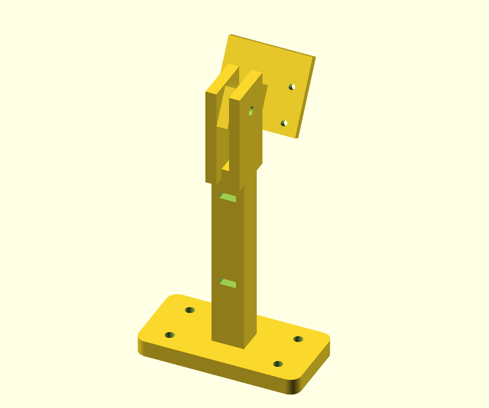

# Parametric top camera mount

**Ready to slice:** [mast STL](camera_mast.stl) · [camera plate STL](camera_plate.stl). These use the source defaults. Re-export both after changing dimensions in OpenSCAD; the STLs do not update themselves.

[`camera_mount.scad`](camera_mount.scad) prints a deck mast and a tilting Camera Module 3 plate. In OpenSCAD set `part="mast"`, render (F6), export STL; repeat with `part="camera"`. The default layout displays both spaced apart for inspection. `part="assembly"` previews the assembled parts; set `tilt` from **0 to 45 degrees downward**. `part="clearance"` checks their intersection: an empty result is expected. The plate sits forward of the ears and the mast stops below the tang's sweep. Print PETG, 0.20 mm layers, 4 walls, 30% infill; mast base flat on bed. The camera plate export is oriented face down; use a brim for the tall hinge tang and inspect the M3 hinge bore after printing. Check your slicer preview before printing.

**Fasteners:** four M3 deck bolts with washers/nylocs (M3×16 or ×20 for the default 6 mm base and a 3 mm deck; measure the stack), one M3×20 hinge bolt with washers/nyloc, four M2 camera bolts with nuts and 3 mm insulating spacers (typically M2×12; check protrusion), and two soft cable straps. Use washers to spread the load on the wooden deck.

- Mast: default hinge axis **100 mm above deck**; edit `mast_height` for the actual fridge/shelf. Foot is 60 × 30 × 6 mm with four Ø3.4 mm holes on **40 × 16 mm centres**. Position on rear deck, check below for wires/battery, mark and drill four M3 through-holes; use M3 bolts, washers and nylocs. This is a new pattern, **not** a claim that the existing deck has matching holes.
- Hinge: one M3 through-bolt and nyloc through both mast ears and the plate tang; do not overtighten plastic. Tilt around left-right axis until the **shelf object and gripper jaws are visible in the same image**, then tighten. Avoid collision at full arm sweep.
- Camera board: four Ø2.3 mm through-holes for **M2** hardware on **21 × 12.5 mm centres**. The [official Camera Module 3 drawing](https://datasheets.raspberrypi.com/camera/camera-module-3-standard-mechanical-drawing.pdf) specifies 25 × 23.862 mm board and Ø2.2 mm holes; [Raspberry Pi says](https://www.raspberrypi.com/documentation/accessories/camera.html) the Module 3/Wide board and holes match Module 2. Hole centres are 2 mm in from each side and about 4 mm from the lower edge. Measure your actual board before tightening. Use four **3 mm insulating spacers** between PCB and plate (increase if the rear connector needs more room); choose screw length for plate, spacer, PCB and nut without touching components. Camera lens faces outward; plate sits behind PCB, so it needs no lens cutout.
- Cable: ribbon exits the board’s lower connector, free of the plate edge. Leave a service loop at the hinge, run it down the back of the mast using soft straps through the two slots, then to the Pi’s CSI socket. No sharp fold, pinched cable or contact with wheels/arm. Power off for insertion; Pi 5 needs the correct 22-to-15-pin cable.

With the mast on the robot, open `http://192.168.4.1/snap.jpg` or run `python -m hasami_walker snap shelf.jpg` on the connected laptop. Adjust height/tilt and lighting until item and jaws stay in frame through the approach. This mount is **unverified on the physical deck and camera**; check the first print against the actual board and available deck space.

**CAD verification (28 Oct 2026):** both default parts exported with OpenSCAD 2021.01 as simple 3D solids. Boolean intersection checks at 0°, 5°, 10°, 15°, 20°, 25°, 30°, 35°, 40° and 45° were empty. The preview shows a 30° tilt. This checks the printed-part geometry; fasteners, camera PCB, ribbon, print tolerances and robot clearance still need a physical fit check.
